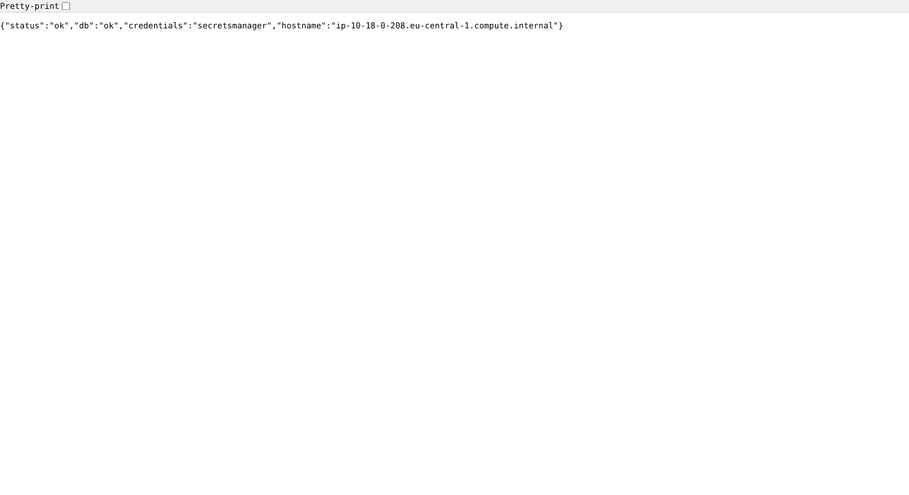
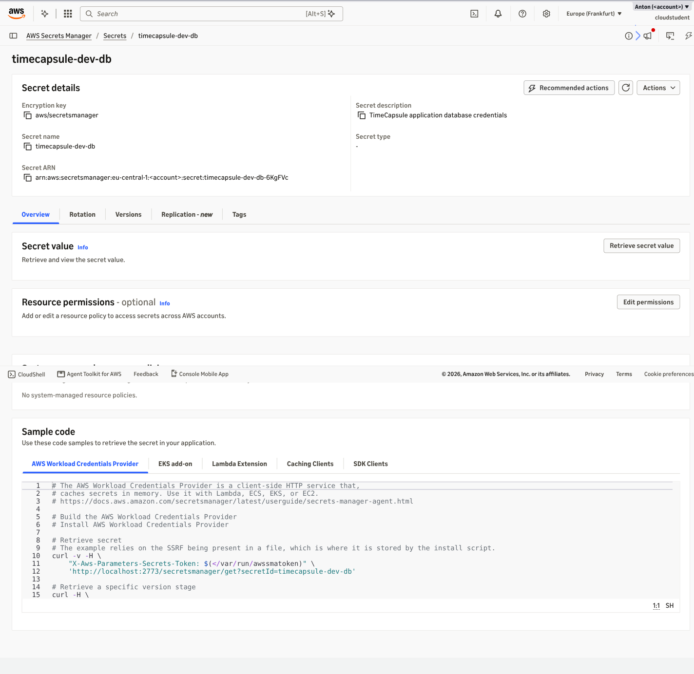
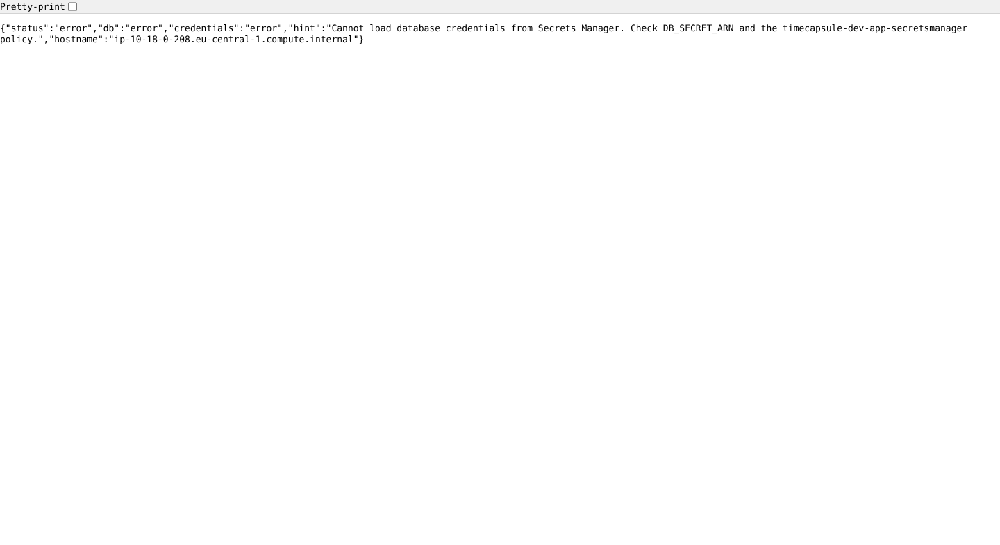

# Индивидуальная работа. Вариант B

**ФИО:** Пустовой Алексей  
**Группа:** IA2404 · **Специальность:** прикладная информатика  
**Вариант:** B, продвинутый  
**Сервис:** AWS Secrets Manager  
**Регион:** `eu-central-1`  
**Репозиторий:** [timecapsule](https://github.com/LesikAWSLabsAAAAAA/timecapsule)

## Проблема

Пароль роли PostgreSQL `timecapsule` лежал в `.env` на
`timecapsule-dev-app`. Образ ЛР6 создаётся как копия корневого диска этого
сервера, поэтому пароль попадал в каждый AMI. Кроме того, тот же пароль был
в переменных окружения Lambda mailer/opener и в локальном state ЛР7.
Пароль был длиной **3 символа**.

Шифрование RDS на уровне хранения не защищает от этой проблемы: приложение
само подключается с паролем, а получивший старый AMI или state получает
рабочий доступ к базе. Ротация требовала вручную обновить сервер, два AMI и
две Lambda, поэтому на практике не выполнялась.

**Метрика до изменений:** число AMI с действующим паролем БД и длина
пароля. В аккаунте было два self-owned AMI; самый новый
`timecapsule-dev-app-lab6` создан из текущего `timecapsule-dev-app` и
содержал действующий пароль. Итого: **1/1 актуальный AMI с рабочим паролем,
3 символа, 6 известных копий** (сервер, два AMI, две Lambda, state).

После ротации старый пароль проверен через `psql`:
`password authentication failed`. В новом AMI и `.env` строки
`DB_PASSWORD` больше нет (`grep -c '^DB_PASSWORD=' .env` → `0`).

## Что сделано

- Создан секрет `timecapsule-dev-db` с полями `username`, `password`,
  `host`, `port`, `dbname`, `engine`. Пароль ротирован на случайные
  **43 символа**.
- Создана customer-managed policy **`timecapsule-dev-app-secretsmanager`**:
  только `secretsmanager:GetSecretValue` на ARN этого секрета, с условиями
  `aws:RequestedRegion = eu-central-1` и `aws:SecureTransport = true`.
  Политика прикреплена к роли `timecapsule-dev-app-role`.
- Приложение читает `DB_SECRET_ARN` из env, получает пароль через
  `Aws\SecretsManager\SecretsManagerClient` и кэширует его в tmpfs
  (`/dev/shm`) на 300 секунд. Ключей доступа нет: используется instance role.
- `src/secrets.php` — адаптер Secrets Manager, `src/db.php` — использование
  пароля, `src/controllers/health.php` — признак `credentials`, `bin/check-secret.php`
  — проверка без вывода пароля.
- Новый AMI `timecapsule-dev-app-individual-20261127` собран после удаления
  `DB_PASSWORD`; приложение запущено в `timecapsule-dev-individual-asg` за
  `timecapsule-dev-individual-alb`. Lambda mailer/opener обновлены на новый
  пароль через их OpenTofu-стек.
- OpenTofu: `docs/individual/tofu/secrets`, `docs/individual/tofu/image`,
  `docs/individual/tofu/app`.

**Pull request:** <!-- PR_LINK -->

**Политика IAM:** [iam-policy.json](iam-policy.json) (номер аккаунта заменён
на `<account>`), ARN policy:
`arn:aws:iam::<account>:policy/timecapsule-dev-app-secretsmanager`.

**ADR:** [ADR-0008](../adr/0008-db-credentials-secrets-manager.md).

## Архитектура

Схема сгенерирована скриптом [architecture.py](architecture.py) в стиле
ЛР5–ЛР7 (`diagrams` + Graphviz). Новый путь запроса:
`браузер → ALB → PHP/ASG → GetSecretValue(DB_SECRET_ARN) → Secrets Manager →
пароль (кэш 300 с) → PHP → RDS PostgreSQL`. Файлы и сессии по-прежнему идут
в S3 и DynamoDB, события — в SNS/SQS/Lambda.

## B3. Измерения

| Метрика | До | После |
| --- | --- | --- |
| AMI с действующим паролем БД | 1/1 (lab6) | 0/1; старый пароль отвергается |
| Известные копии активного пароля | 6 | 0 в приложении/AMI; 2 в Lambda env обновлены на новый пароль, state локальный |
| Длина пароля | 3 символа | 43 символа |
| Источник пароля в `/health` | `env` | `secretsmanager` |
| Холодное чтение секрета | — | 138–346 мс |
| Чтение из кэша | — | 0–1 мс |
| `POST /capsules` при работающем приложении | 302, капсула создана | 302, капсула создана |
| B4: `/health` после `Deny` | — | HTTP 500, `credentials: error` |
| B4: ALB target health | — | `unhealthy`, `Target.ResponseCodeMismatch` |
| B4: статика `/css/app.css` | — | HTTP 200 |
| B4: Lambda opener | — | `{"eventType":"capsules.opened","openedCount":1}` |

Проверки выполнялись на тестовом пользователе
`individual-secrets-1795739589@example.com`, капсула №10 и фоновая капсула
№11. Пароли и номер аккаунта в отчёт не включены.

## B4. Сбой доступа к сервису

1. В policy `timecapsule-dev-app-secretsmanager` вместо `Allow` применён
   явный `Deny` (`docs/individual/iam-policy-b4-deny.json`), кэш очищен,
   PHP-FPM перезапущен.
2. Пользователь видит HTTP **500** на `/wall` и `/health`:
   «Cannot load database credentials from Secrets Manager…». ALB помечает
   target как `unhealthy`; статика `/css/app.css` продолжает отдаваться с
   200, error page рендерится без БД.
3. Фоновые функции не зависят от приложения: Lambda opener с собственным
   паролем открыл капсулу №11 и записал уведомление
   (`openedCount: 1`). Это подтверждает, что сбой локализован в веб-пути,
   а не во всей системе.
4. После возврата `Allow` и замены ASG-инстансов (свежие credentials)
   `/health` снова 200, капсула и стена открываются.

Особенность: IAM eventual consistency и кэш 300 с могут задержать
обнаружение сбоя. В одном опыте инстанс ещё отдавал закэшированный пароль,
пока другой уже получал `AccessDeniedException`; для продакшена нужен
меньший TTL или отдельный no-cache health probe. Это записано в ADR.

Скриншоты:

Фоновая проверка: [07-opener-b4.json](evidence/07-opener-b4.json),
[08-b4-background-job.txt](evidence/08-b4-background-job.txt),
[09-b4-target-health.txt](evidence/09-b4-target-health.txt).

## B5. Обоснование

Полное сравнение, плюсы/минусы и последствия — в
[ADR-0008](../adr/0008-db-credentials-secrets-manager.md). Кратко:

- **Как есть:** $0, но 6 копий 3-символьного пароля, ручная ротация, нет
  аудита.
- **Без нового сервиса (RDS IAM authentication):** $0, статического пароля
  нет, но нужны IAM auth на RDS, роль `rds_iam`, TLS и token на каждое
  подключение; текущий PDO создаётся на запрос, поэтому это добавило бы
  задержку.
- **Secrets Manager:** ~$0.49/мес при 10 000 пользователях (200 000
  запросов, 2 инстанса, кэш 300 с), один секрет, 43 символа, минимальная
  IAM-политика, аудит и ротация. Минусы: главный путь, 500 при отказе,
  задержка обнаружения из-за кэша/IAM, две копии в Lambda env.

Допущения стоимости: 10 000 активных пользователей в месяц, 20 запросов на
пользователя, 2 инстанса, TTL 300 с. Вызовы Secrets Manager:
2 × 12 × 24 × 30 = 17 280/мес ≈ $0.09; секрет $0.40; итого ≈ $0.49/мес.
Без кэша 200 000 вызовов ≈ $1.00 + $0.40 = $1.40/мес. Стоимость EC2, RDS,
ALB и S3 считается отдельно; на учебном стенде доминирует время жизни
ресурсов, а не вызовы Secrets Manager.

## Контрольные вопросы

**Какую проблему TimeCapsule решил сервис и чем это подтверждается?**
Пароль БД больше не хранится в `.env` и AMI: 6 копий сократились до одного
секрета, длина выросла с 3 до 43 символов, старый пароль после ротации
отвергается PostgreSQL, а `/health` показывает `credentials: secretsmanager`.
Это подтверждено таблицей B3 и проверкой `psql`.

**Какие обязанности перешли к AWS, а какие добавились вам?**
AWS хранит секрет, шифрует его, ведёт аудит и позволяет ротацию. Мы
отвечаем за IAM-политику, TTL кэша, обработку ошибок и 500, ротацию,
обновление Lambda, стоимость и наблюдаемость. Сбой B4 показал, что
ответственность за доступность главного пути остаётся на приложении.

**Что придётся переделать, если отказаться от сервиса или перейти к другому
провайдеру?**
Достаточно заменить `src/secrets.php` на адаптер Vault/SSM или на RDS IAM
authentication. Переменная `DB_SECRET_ARN`, логика кэша и обработка ошибок
останутся; изменится только источник пароля и IAM-политика. Если уходить из
AWS, секрет нужно перенести до переключения, иначе приложение не сможет
подключиться к БД.

## Очистка

После защиты удалить `timecapsule-dev-individual-asg`, ALB, target group,
launch template, AMI и снимок, секрет, policy и тестовые данные. Остановка
EC2/RDS не удаляет EBS, снимки, публичный IPv4 и секрет. Проверить остатки
по тегам `Project=timecapsule` и `Lab=individual` и в Billing через день
после удаления.
