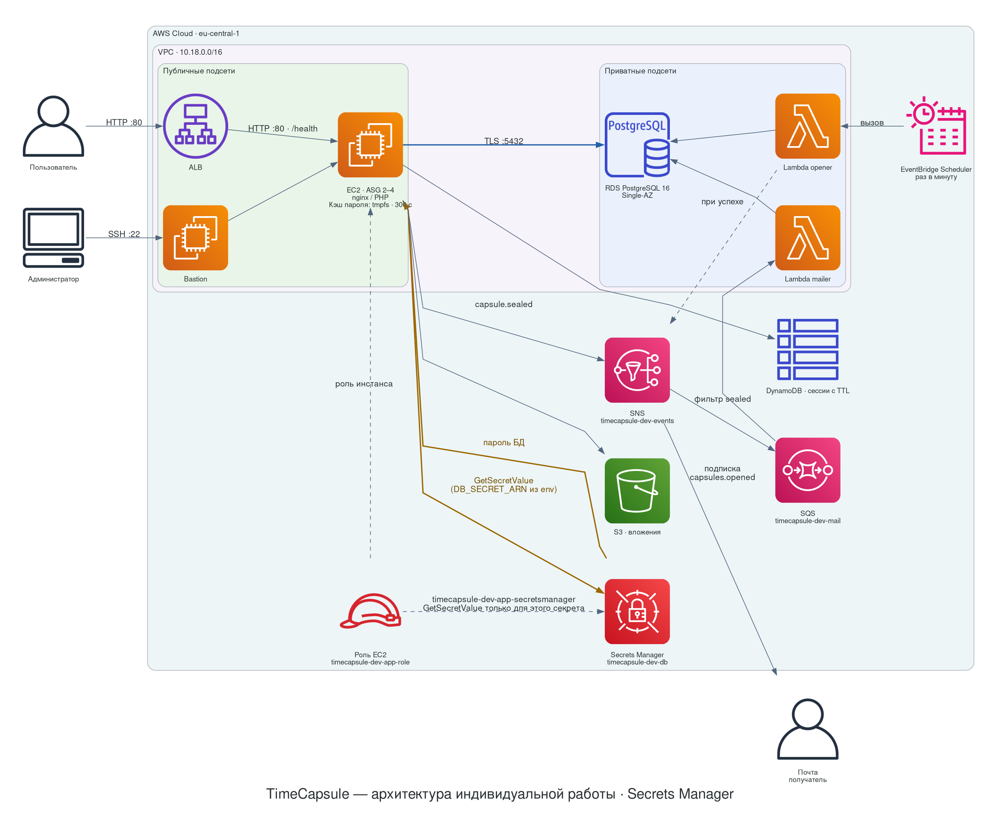
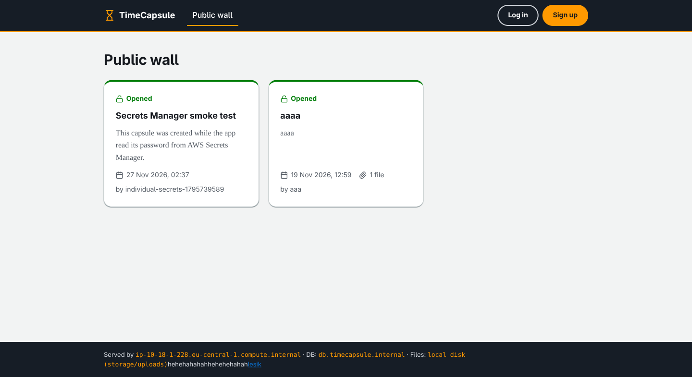
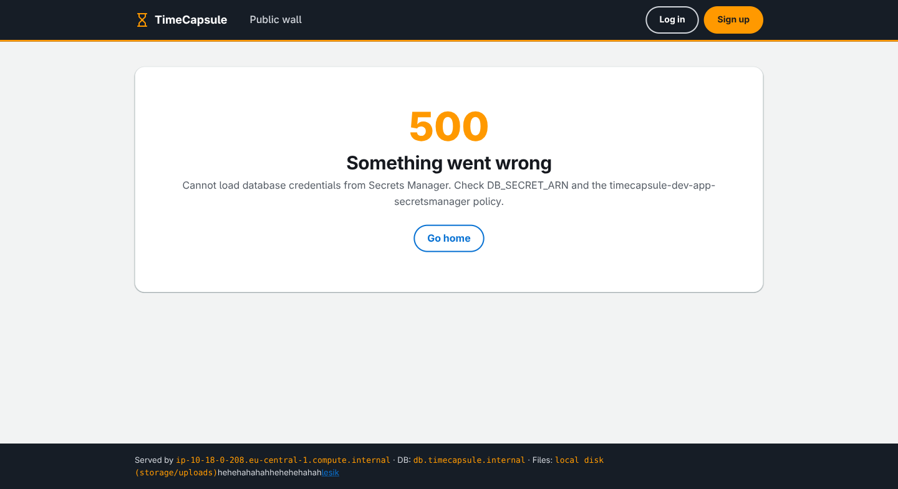

# Индивидуальная работа. Вариант B

**ФИО:** Пустовой Алексей  
**Группа:** IA2404 · **Специальность:** прикладная информатика  
**Вариант:** B, продвинутый  
**Сервис:** AWS Secrets Manager  
**Регион:** `eu-central-1`  
**Репозиторий:** [timecapsule](https://github.com/LesikAWSLabsAAAAAA/timecapsule)

## Проблема

Пароль роли PostgreSQL `timecapsule` лежал в `.env` на
`timecapsule-dev-app`. Образ ЛР6 создаётся как копия корневого диска этого
сервера, поэтому пароль попадал в каждый AMI. Кроме того, тот же пароль был
в переменных окружения Lambda mailer/opener и в локальном state ЛР7.
Пароль был длиной **3 символа**.

Шифрование RDS на уровне хранения не защищает от этой проблемы: приложение
само подключается с паролем, а получивший старый AMI или state получает
рабочий доступ к базе. Ротация требовала вручную обновить сервер, два AMI и
две Lambda, поэтому на практике не выполнялась.

**Метрики и цель:** уменьшить число AMI с действующим паролем с **1 из 2**
до нуля и увеличить длину пароля с **3** до как минимум **32 символов**.
Эти метрики показывают, можно ли воспользоваться паролем из старого образа
и изменился ли пароль с ротацией. Отдельно проверяем, что нового пароля нет
в `.env` веб-приложения и новом AMI, а старый отвергается PostgreSQL.

## B2. Внедрение

- Создан секрет `timecapsule-dev-db` с полями `username`, `password`,
  `host`, `port`, `dbname`, `engine`. Пароль ротирован на случайные
  **43 символа**.
- Создана customer-managed policy **`timecapsule-dev-app-secretsmanager`**:
  только `secretsmanager:GetSecretValue` на ARN этого секрета, с условиями
  `aws:RequestedRegion = eu-central-1` и `aws:SecureTransport = true`.
  Политика прикреплена к роли `timecapsule-dev-app-role`.
- Приложение читает `DB_SECRET_ARN` из env, получает пароль через
  `Aws\SecretsManager\SecretsManagerClient` и кэширует его в tmpfs
  (`/dev/shm`) на 300 секунд. Для доступа SDK использует роль EC2,
  а не ключи, заданные в коде или конфигурации.
- Новый AMI `timecapsule-dev-app-individual-20261127` собран после удаления
  `DB_PASSWORD`; приложение запущено в `timecapsule-dev-individual-asg` за
  `timecapsule-dev-individual-alb`, по той же схеме AMI → Auto Scaling,
  что и в лабораторной. Для ресурсов добавлен тег `Lab=individual`.
- Код интеграции: [`src/secrets.php`](../../src/secrets.php) и
  [`src/db.php`](../../src/db.php). Конфигурация выпуска:
  [OpenTofu](tofu/README.md).

ARN секрета, регион и параметры подключения к БД приложение получает из
окружения: `DB_SECRET_ARN`, `AWS_REGION`, `DB_HOST`, `DB_PORT`, `DB_NAME`,
`DB_USER`.

**Pull request:** [#1](https://github.com/LesikAWSLabsAAAAAA/timecapsule/pull/1)
(ветка `individual/secrets-manager`, base `master`).

**Политика IAM:** [iam-policy.json](iam-policy.json) (номер аккаунта заменён
на `<account>`); [исходник OpenTofu](tofu/secrets/main.tf).

**ADR:** [ADR-0008](../adr/0008-db-credentials-secrets-manager.md).

**Слайды для защиты:** [presentation.pdf](presentation.pdf) · исходник
[presentation.tex](presentation.tex).

## Архитектура

Запрос идёт от браузера через ALB к PHP на EC2 в группе Auto Scaling.
Если в кэше нет актуального пароля, PHP вызывает `GetSecretValue` по
`DB_SECRET_ARN`, кэширует пароль на 300 секунд и подключается к RDS PostgreSQL.
При попадании в кэш запрос к Secrets Manager не выполняется.

## B3. Измерения

| Метрика | До | После |
| --- | --- | --- |
| Исходные AMI с действующим паролем БД | 1/2 | 0/2 после ротации |
| `DB_PASSWORD` в `.env` веб-приложения | Есть | Нет; в `.env` нового AMI строки тоже нет |
| Длина пароля | 3 символа | 43 символа |
| Источник пароля в `/health` | `env` | `secretsmanager` |
| Холодное чтение секрета | — | 138–346 мс |
| Чтение из кэша | — | 0–1 мс |
| `POST /capsules` при работающем приложении | 302, капсула создана | 302, капсула создана |

Доказательства: [инвентаризация до изменений](evidence/10-baseline-inventory.txt),
[замеры чтения секрета](evidence/11-secret-measurements.txt),
[отказ PostgreSQL при входе со старым паролем](evidence/13-old-password-rejected.txt).
Замеры чтения секрета не измеряют полное время ответа веб-страницы.

## B4. Сбой доступа к сервису

1. Вместо `Allow` применён явный [`Deny`](iam-policy-b4-deny.json),
   кэш очищен, PHP-FPM перезапущен.
2. `/wall` и `/health` вернули HTTP **500**, а ALB пометил цели как
   `unhealthy`. Стена не работает без подключения к БД. Статика
   `/css/app.css` по-прежнему вернула **200**, а Lambda opener открыл
   фоновую капсулу (`openedCount: 1`).
3. После возврата `Allow` и замены инстансов в Auto Scaling `/health`
   снова вернул **200**, стена и капсула открылись.

**Как заметить сбой раньше пользователя?** Кэш и задержка применения IAM
могут скрыть отказ от проверки ALB. Проверка `GetSecretValue` в обход кэша
с уведомлением помогла бы заметить его раньше; в этой работе её не внедряли.

Скриншоты:

Дополнительные скриншоты и журналы: [evidence](evidence/README.md).

## B5. Обоснование

Полное сравнение — в [ADR-0008](../adr/0008-db-credentials-secrets-manager.md).
В таблице показаны добавочные расходы, без EC2, RDS, ALB и S3. Для учебной
нагрузки оценка начинается с $0.40 за один секрет в месяц; запросы
оплачиваются отдельно. Для 10 000 активных пользователей предполагаем
20 запросов на человека в месяц и два постоянно работающих инстанса.
При TTL 300 с и непрерывном обращении к БД модель даёт
2 × 12 × 24 × 30 = 17 280 чтений секрета в месяц, или около $0.09 сверх
цены секрета. Без кэша при одном чтении на запрос оценка составит $1.40 в
месяц. Это модель по [тарифу AWS](https://aws.amazon.com/secretsmanager/pricing/),
не данные счёта.

| Критерий | Как есть | Без нового сервиса: RDS IAM auth | Secrets Manager |
| --- | --- | --- | --- |
| Стоимость в месяц при учебной нагрузке | $0 | $0 | ~$0.40 за секрет + центы за вызовы |
| Стоимость при 10 000 пользователей | $0 | $0 | ~$0.49/мес (200 000 запросов, кэш 300 с) |
| Что поддерживать вам | Обновлять пароль в местах хранения; раньше было 5 действующих копий | RDS IAM auth, роль `rds_iam`, TLS, токен на новое подключение | IAM, кэш, обработка отказа и ротация |
| Скорость для пользователя | Чтение из окружения без сетевого вызова | Токен на новое подключение; задержка не измерялась | Чтение секрета: 0–1 мс из кэша, 138–346 мс без кэша |
| Безопасность и данные | 3-символьный пароль попадал в AMI; нет аудита чтения из `.env` | Нет статического пароля; доступ через IAM | 43 символа, ограничение доступа по IAM, аудит обращений к секрету |
| Что переписать при переезде из AWS | Для чтения пароля из окружения — ничего | Заменить выдачу токена и логику подключения в `src/db.php` | Заменить адаптер `src/secrets.php`, настройки доступа и перенести секрет |
| Сложность разработки и выпуска | низкая | средняя | средняя |

Если бы я платил сам, выбрал бы Secrets Manager: примерно $0.49 в месяц в
этом сценарии оправдывают отказ от пароля в образе веб-приложения и
возможность аудита. При почти нулевой нагрузке, если главное — не платить
отдельно за хранение секрета, рассмотрел бы RDS IAM authentication.

## Контрольные вопросы

**Какую проблему TimeCapsule решил сервис и чем это подтверждается?**
Веб-приложение больше не берёт пароль БД из `.env`, поэтому его не нужно
включать в новый AMI. `/health` показывает `credentials: secretsmanager`,
а проверка через `psql` подтверждает, что старый пароль больше не подходит.

**Какие обязанности перешли к AWS, а какие добавились вам?**
AWS хранит и шифрует секрет и регистрирует обращения к нему. Мы
настраиваем IAM, выбираем TTL кэша, обрабатываем сбои и отвечаем за смену
пароля и доступность веб-приложения.

**Что придётся переделать, если отказаться от сервиса или перейти к другому
провайдеру?**
При переходе на внешнее хранилище нужно заменить адаптер `src/secrets.php`,
перенести секрет и настроить доступ у нового провайдера. При переходе на
RDS IAM authentication нужно также изменить подключение в `src/db.php`
и настроить IAM-аутентификацию на стороне RDS.

## Очистка

В конце занятия остановить или удалить почасовые ресурсы. После защиты
удалить ресурсы проекта с тегом `Project=timecapsule`, в том числе ресурсы
индивидуальной работы (`Lab=individual`). Проверить Billing через день.
