# Лабораторная работа №3. Облачные сети. Amazon VPC

**Студент:** Пустовой Алексей  
**K:** 18, **X:** 18 % 30 = 18  
**Регион:** eu-central-1 (Frankfurt)

## 1. План адресов

Диапазон VPC — `10.18.0.0/16`.

| Подсеть   | Зона          | Диапазон        | Доступные адреса          | Количество |
|-----------|---------------|-----------------|---------------------------|------------|
| public-a  | eu-central-1a | `10.18.0.0/24`  | `10.18.0.4–10.18.0.254`   | 251        |
| public-b  | eu-central-1b | `10.18.1.0/24`  | `10.18.1.4–10.18.1.254`   | 251        |
| private-a | eu-central-1a | `10.18.10.0/24` | `10.18.10.4–10.18.10.254` | 251        |
| private-b | eu-central-1b | `10.18.11.0/24` | `10.18.11.4–10.18.11.254` | 251        |

AWS резервирует первые четыре и последний адрес каждой подсети: адрес сети, адреса для маршрутизатора и DNS, адрес для будущего использования и широковещательный адрес. В VPC помещается 256 подсетей `/24`, после четырёх остаётся ещё 252.

Для примера, в `10.18.0.0/24` заняты адреса `10.18.0.0`–`10.18.0.3` и `10.18.0.255`.

## 2. VPC и подсети

Создана VPC с четырьмя подсетями. Само по себе название public не делает подсеть публичной: для этого нужен маршрут к Internet Gateway.

До добавления такого маршрута public-a остаётся приватной, независимо от её имени и настройки выдачи публичных IP.

## 3. Internet Gateway и маршруты

Подключён Internet Gateway. В публичной таблице маршрут `0.0.0.0/0` ведёт к шлюзу, в приватной постоянного маршрута в интернет нет. В обеих таблицах есть маршрут `10.18.0.0/16 local` для связи внутри VPC. Пакет из приватной подсети на `8.8.8.8` без NAT никуда не уйдёт.

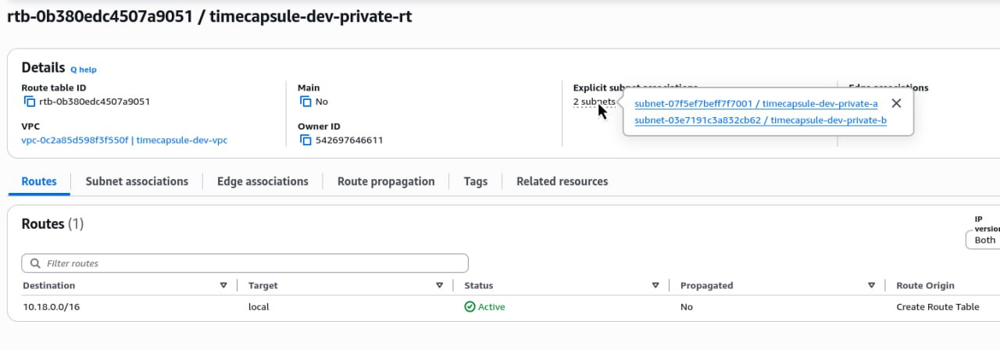
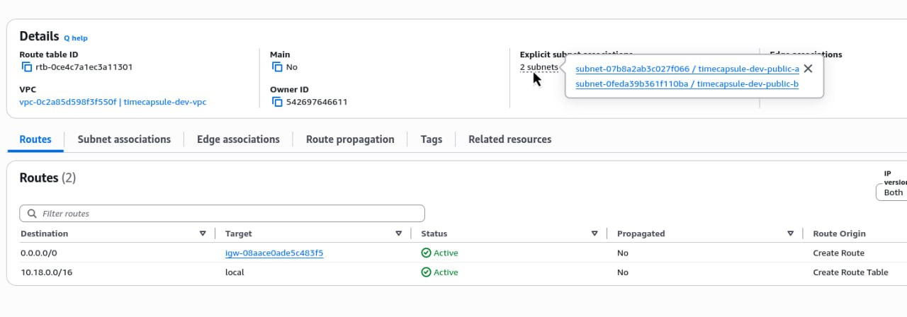

## 4. Security Group

- `bastion-sg` разрешает SSH только с моего IP.
- `web-sg` разрешает HTTP и HTTPS из интернета, SSH — от bastion.
- `db-sg` разрешает PostgreSQL от `web-sg`, SSH — от bastion.

Группа в качестве источника удобнее IP-адреса: правило продолжит работать при смене адреса веб-сервера и не открывает базу всей VPC.

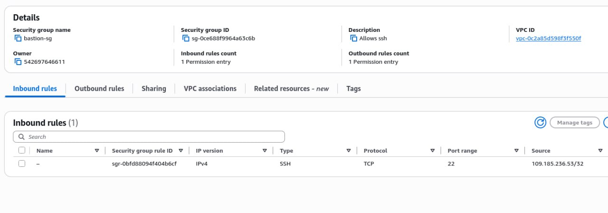
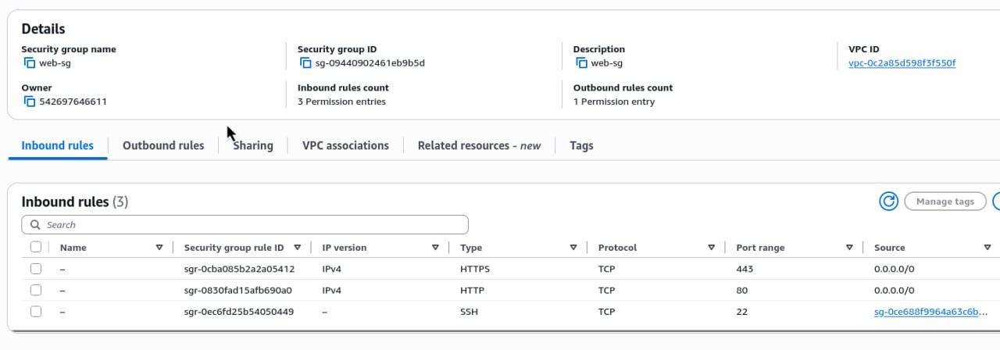
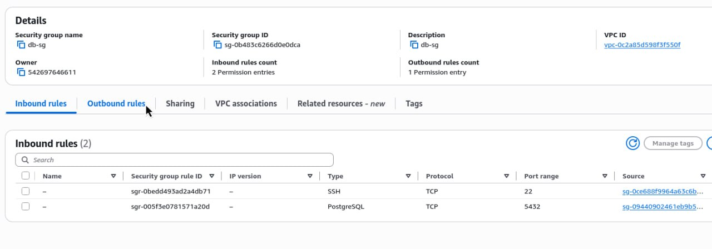

## 5. Серверы

Запущены bastion, веб-сервер и сервер базы. На веб-сервере работает nginx, подключение к внутренним серверам идёт по SSH через bastion. Без NAT сервер базы не может скачать пакеты из интернета.

У веб-сервера есть публичный IP и маршрут через Internet Gateway. У базы публичного IP и маршрута в интернет нет. NAT Gateway позволяет базе самой выходить в интернет, не открывая входящие подключения снаружи.

На скриншотах веб-сервер имеет адрес `10.18.1.210`, а сервер базы — `10.18.11.157`. По плану задания они должны были находиться в public-a и private-a соответственно; эти адреса относятся к диапазонам public-b и private-b.

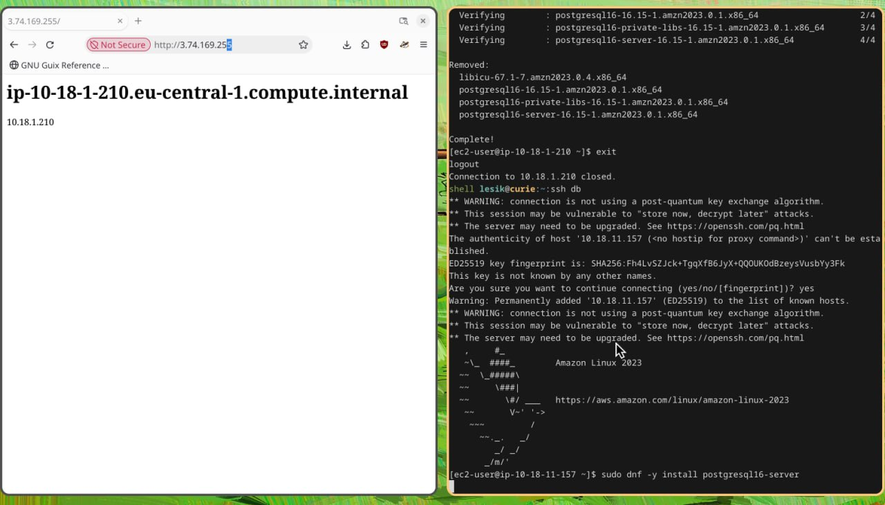

## 6. Временный NAT Gateway

Для установки PostgreSQL использовался NAT Gateway. При выходе в интернет сервер базы видит внешний Elastic IP шлюза, а не свой приватный адрес. После установки шлюз удалён; PostgreSQL продолжает работать внутри VPC. Для обновлений NAT потребуется поднять снова.

Доступ к базе ограничен на нескольких уровнях:

- У сервера базы нет публичного IP и прямого маршрута в интернет.
- `db-sg` разрешает порт 5432 только от группы веб-сервера.
- `pg_hba.conf` дополнительно проверяет, кому и откуда разрешено подключаться к PostgreSQL.

Если ошибиться в одном из этих уровней, остальные всё ещё могут остановить нежелательное подключение. Но полагаться на это не стоит: правильная настройка каждого уровня нужна для надёжной защиты.

На скриншоте после удаления шлюза маршрут ещё находится в состоянии `Blackhole`; такой маршрут нужно удалить, а Elastic IP шлюза — освободить.

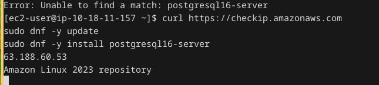
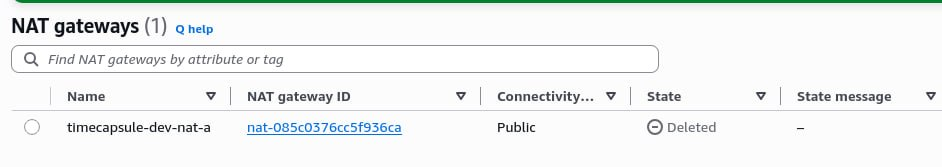
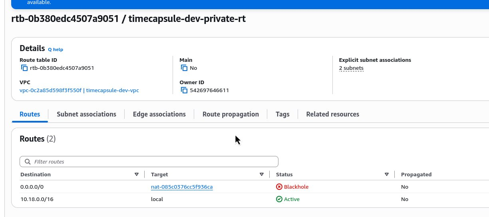

## 7. Проверки

С веб-сервера удалось подключиться к PostgreSQL. Порт 5432 открыт для веб-сервера, но закрыт для bastion: маршрут внутри VPC есть для обоих, а Security Group пропускает только нужный источник.

После удаления NAT запрос с сервера базы в интернет не проходит: в приватной таблице нет рабочего маршрута наружу. Из интернета к базе тоже не подключиться: у неё нет публичного адреса и маршрута через Internet Gateway, а Security Group не разрешает такой входящий трафик.

Network ACL действует на уровне подсети: правило Deny с номером меньше 100 срабатывает раньше разрешающего правила по умолчанию. Поэтому оно может заблокировать и SSH, и сайт, даже если Security Group их разрешает. С другого внешнего IP, например с телефона через мобильную сеть, блокировка по моему IP не действует.

Ресурсы можно найти по тегу `Project = timecapsule`. Тег `Owner` помогает понять, кто отвечает за ресурс, даже если позже аккаунтом будут пользоваться другие люди.

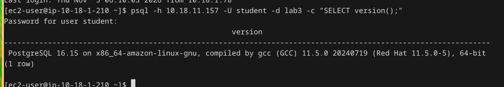
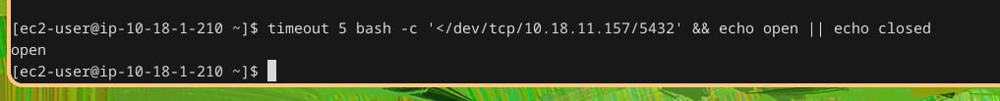
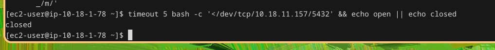
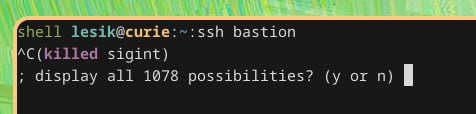
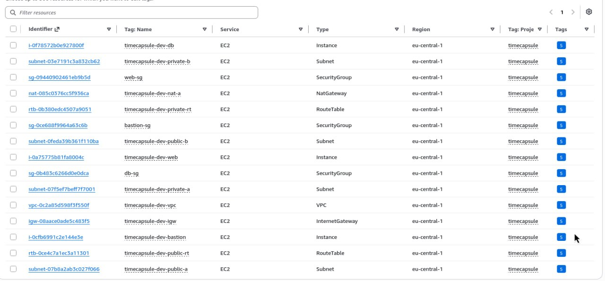

## 8. Перенос сервера

Перенести сам EC2 между VPC нельзя, поэтому для запуска приложения в новой сети используется образ AMI старого сервера. Образ содержит снимок диска с установленными nginx, PHP, приложением, его файлами и локальной базой. До переноса данных база приложения остаётся локальной на app-server.

## 9. Elastic IP

Приложение запущено в новой VPC, для него используется Elastic IP. Постоянный адрес нужен пользователям приложения; адрес bastion можно обновлять в SSH-конфигурации. Elastic IP оплачивается и при остановленном сервере: по оценке в задании это $0,005 в час, поскольку адрес остаётся закреплённым. Если перед приложением появится балансировщик, пользователи смогут обращаться к нему, а Elastic IP самому app-server обычно не понадобится.

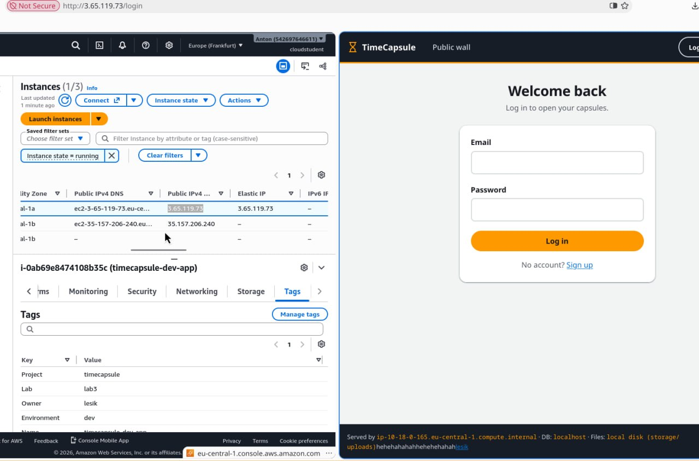

## 10. База приложения

Для базы выбран отдельный сервер в приватной подсети. Даже если порт 5432 ограничен Security Group, нужен сильный пароль: он защищает базу, если правила сети настроят неверно или доступ получит посторонний сервер из разрешённой группы. В `pg_hba.conf` доступ можно дополнительно ограничить конкретной базой, пользователем и подсетью.

## 11. Приватная зона Route 53

Создана зона `timecapsule.internal` и запись `db.timecapsule.internal`, указывающая на `10.18.11.157`. Имя разрешается внутри VPC, но не на обычном домашнем компьютере. При смене адреса сервера базы нужно обновить запись.

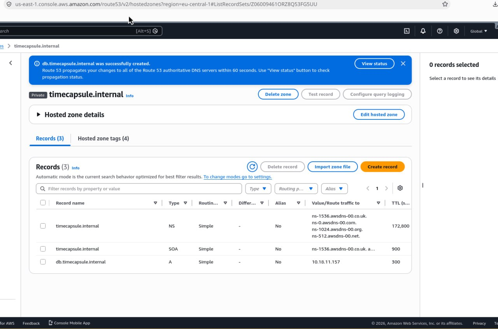
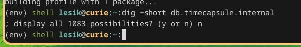
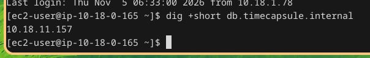

## 12. Перенос данных

Данные базы переносятся через `pg_dump` и `psql`, после чего приложение переключается на `db.timecapsule.internal`. Проверка `/health` вернула `db: ok`.

После переключения локальную PostgreSQL на app-server нужно остановить: так можно убедиться, что приложение действительно использует отдельный сервер базы.

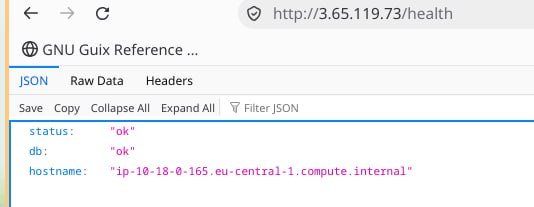

Загруженные пользователями файлы хранятся на диске сервера приложения, а не в базе. При удалении сервера их можно потерять, если заранее не сохранить диск или копию файлов.

## 13. Деплой и обслуживание

- **Почему команды деплоя не нужно менять?** Приложение обновляется на самом app-server так же, как раньше. Меняется способ SSH-подключения: теперь оно идёт через bastion, что задаётся в SSH-конфигурации.
- **Что будет при остановке базы?** По коду приложения `/health` возвращает HTTP 500 и `db: error`, если не удалось подключиться к базе. Ответ может прийти не сразу, пока приложение ждёт соединения. При обычной остановке и запуске того же EC2 его приватный IP сохраняется, поэтому после запуска базы подключение может восстановиться без изменения настроек приложения.
- **Почему Elastic IP NAT освобождают после удаления шлюза?** Пока адрес привязан к NAT Gateway, AWS не позволит его освободить. После удаления иногда нужно немного подождать, пока привязка исчезнет.

Это ответы на вопросы по обслуживанию; скриншотов проверки отказа базы и повторного обновления пакетов в отчёте нет.

## 14. Архитектура

Схема показывает приложение после переноса. Подсети и зоны подписаны по плану из задания; адрес базы на скриншотах относится к диапазону private-b. NAT Gateway показан пунктиром, потому что нужен только на время установки пакетов и обновлений.

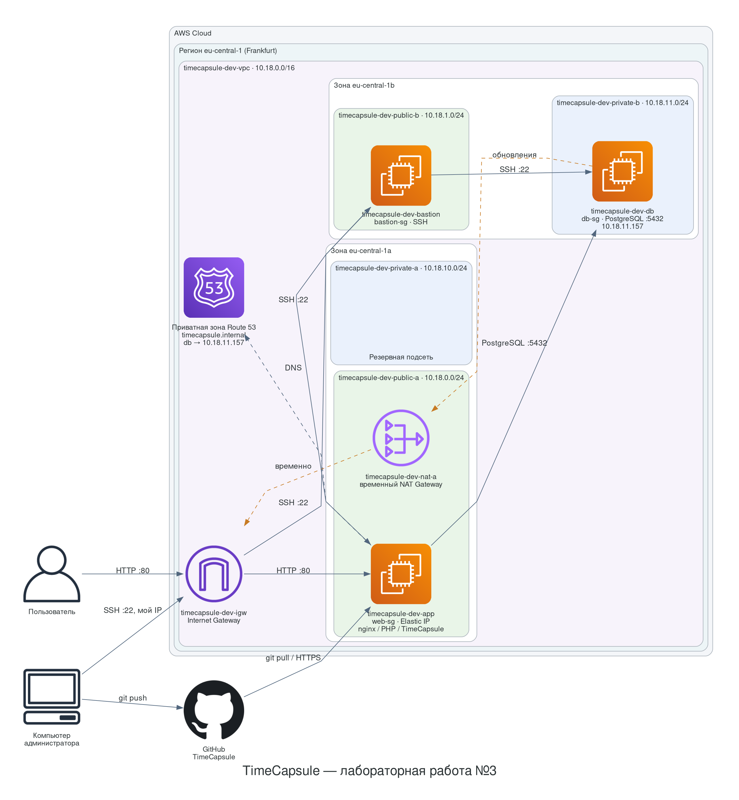

## Архитектурное решение

Базу выбрано размещать на отдельном сервере в приватной подсети. Краткое сравнение вариантов — в [ADR-0002](../adr/0002-database-placement.md).

## Вывод

В работе настроена сеть VPC с публичными и приватными подсетями, доступом через bastion и правилами Security Group. Приложению выделен постоянный адрес, а для базы настроено внутреннее DNS-имя.
