# Лабораторная работа №4. Облачные хранилища. Amazon S3

**Студент:** Пустовой Алексей  
**Группа:** IA2404  
**Уровень:** продвинутый  
**Приложение:** `open_capsules_php_functional`  
**Регион:** `eu-central-1` (Frankfurt)  
**Репозиторий:** [LesikAWSLabsAAAAAA/timecapsule](https://github.com/LesikAWSLabsAAAAAA/timecapsule)

## Цель работы

Изучить объектное хранилище S3, управление доступом, версиями и жизненным циклом объектов; рассмотреть перенос вложений приложения с диска сервера в S3 и выдачу файлов по подписанным URL.

Результаты ниже описаны по предоставленным скриншотам и текущему состоянию репозитория. Там, где подтверждения проверки нет, приведено ожидаемое поведение, а не выданный за фактический результат вывод.

## Часть 1. Базовый уровень

### 1. Бакет и объекты в консоли

Бакет называется `timecapsule-dev-uploads-lesik`. На скриншотах показаны префиксы `uploads/` и `backups/` и свойства картинки `uploads/graphviz.png`: размер 86 318 байт, ETag `8a08db89d5d186632bb4757602b29601`, регион `eu-central-1`. При просмотре метаданных в задании 2 определены `Content-Type: image/png` и шифрование `AES256` (SSE-S3).

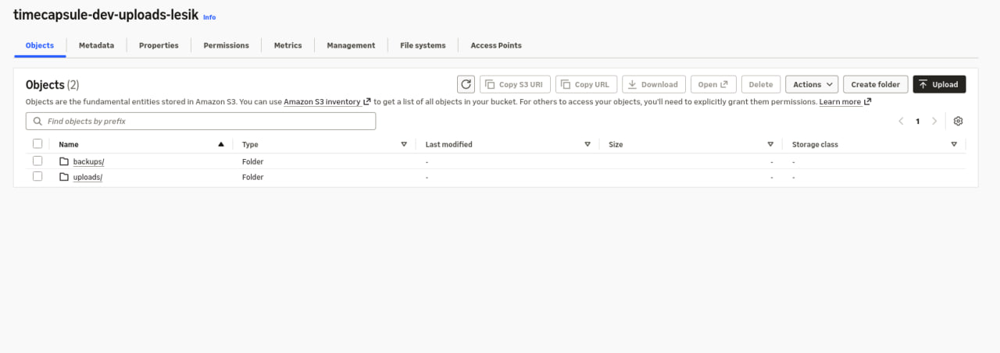
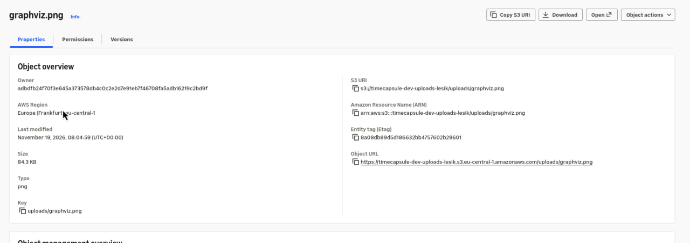

- **Какой ключ у картинки?** Полный ключ внутри бакета — `uploads/graphviz.png`; имя бакета в ключ не входит.
- **Почему Object URL не открывается у владельца?** Обычное открытие прямого URL в браузере не подписывает запрос учётными данными IAM. Владение бакетом или вход в консоль не превращает такой запрос в авторизованный: при закрытом публичном доступе S3 возвращает `AccessDenied`.
- **Что создала кнопка Create folder?** В S3 плоское пространство ключей; папка — представление префикса. Консоль обычно создаёт пустой объект-маркер с ключом, оканчивающимся на `/`, чтобы пустая папка была видна.

### 2. Объекты из командной строки

Три варианта `aws s3 ls` показывают префиксы на верхнем уровне, содержимое `uploads/` и полный рекурсивный список. На скриншоте также видны текстовые объекты `uploads/2026/10/report.txt`, `uploads/2026/10/report-2.txt` и `backups/channels.scm`. Метаданные картинки получены через `head-object`; скачивание `photo.txt` и удаление `report-2.txt` видны на скриншоте задания 3.

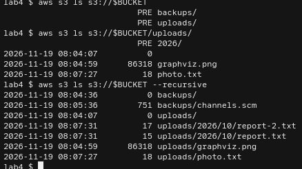
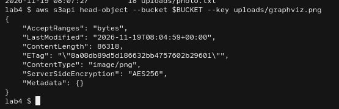

- **Почему первый `ls` показывает `PRE`, а рекурсивный — полные ключи?** Без `--recursive` CLI использует разделитель `/` и группирует ключи по общим префиксам, показывая их как `PRE`. При рекурсивном обходе он выводит отдельные объекты с полными ключами; папки не являются настоящими каталогами S3.
- **Какой Content-Type у `report.txt`?** Обычно `aws s3 cp`/`sync` определяет тип по расширению и устанавливает `text/plain`, хотя он явно не задан.

### 3. Политика бакета: только HTTPS

Политика на скриншоте запрещает все действия S3 над бакетом и его объектами при `aws:SecureTransport = false`:

```json
{
  "Version": "2012-10-17",
  "Statement": [{
    "Sid": "DenyInsecureTransport",
    "Effect": "Deny",
    "Principal": "*",
    "Action": "s3:*",
    "Resource": [
      "arn:aws:s3:::timecapsule-dev-uploads-lesik",
      "arn:aws:s3:::timecapsule-dev-uploads-lesik/*"
    ],
    "Condition": {"Bool": {"aws:SecureTransport": "false"}}
  }]
}
```

На скриншоте обычный `aws s3 ls` выполняется, а запрос к HTTP endpoint возвращает `AccessDenied` с указанием явного запрета в ресурсной политике.

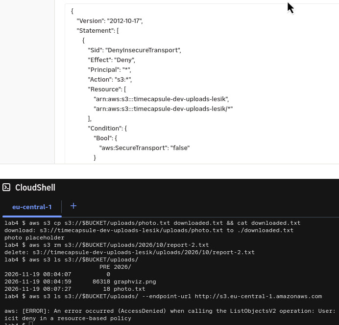


- **Почему администратор получает отказ по HTTP?** Явный `Deny` в политике бакета имеет приоритет над разрешением, в том числе над административными правами. HTTPS-запрос всё равно должен отдельно пройти проверку разрешений.
- **Почему Block Public Access не помешал политике с `Principal: "*"`?** Здесь `Principal` определяет, к кому применяется именно запрет, а не предоставляет кому-либо доступ. Такая политика не делает бакет публичным.

### 4. Версионирование и защита от удаления

После включения версионирования ранее загруженные объекты имеют версию `null`. На первом снимке у `notes.txt` видны две версии и маркер удаления, на втором — одна оставшаяся версия после отката. Содержимое версий на снимках не показано.

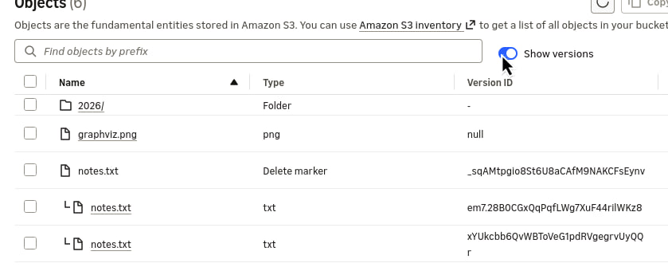
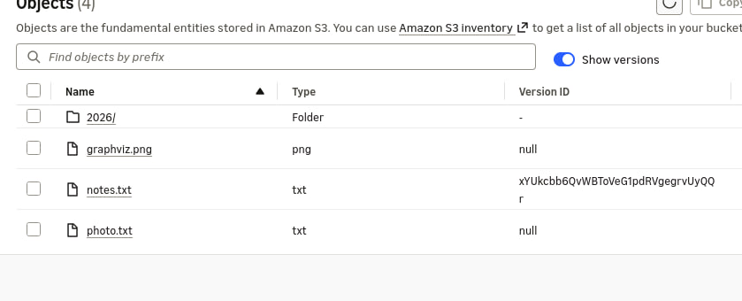

- **Чем отличаются два удаления?** Обычное удаление объекта без `VersionId` в бакете с включённым версионированием создаёт текущий delete marker и скрывает объект, сохраняя его предыдущие версии. Удаление конкретной версии с `VersionId` окончательно удаляет именно её.
- **Что можно отменить и какие права дать приложению?** Удалив маркер, можно снова сделать предыдущую версию текущей; удалённую конкретную версию так восстановить нельзя. От случайного обычного удаления защищает версионирование, а приложению не следует давать `s3:DeleteObjectVersion`.

### 5. Правило жизненного цикла

По заданию правило `timecapsule-dev-noncurrent` должно действовать только на `uploads/`: переводить неактуальные версии в Standard-IA через 30 дней, удалять их через 90 дней с сохранением двух самых новых неактуальных версий и прекращать незавершённые multipart-загрузки через 7 дней. `backups/` под это правило не попадает.

```text
uploads/                       backups/ — вне области правила
   │
   ├─ версия стала неактуальной ── 30 дней ──► Standard-IA*
   │                                90 дней ──► удалить версии старше двух новейших**
   └─ незавершённая multipart-загрузка ── 7 дней ──► прервать и удалить части

* При выполнении условий перехода, включая минимальный размер объекта.
** Если одновременно выполнены условия возраста и количества новых версий.
```

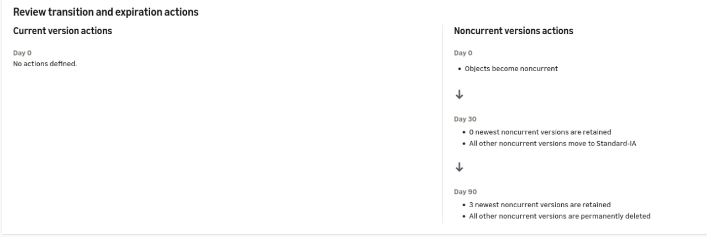

- **Что будет после десяти перезаписей за неделю?** Если исходный файл перезаписан десять раз, получится одна текущая и десять неактуальных версий. При настройке из задания подходящие по размеру неактуальные версии станут кандидатами на переход через 30 дней после утраты актуальности; через 90 дней S3 сможет удалить версии, для которых есть более двух новых неактуальных версий, сохраняя две новейшие. При показанной на снимке настройке останутся три, а действия lifecycle выполняются асинхронно, не обязательно точно в момент наступления срока.
- **Почему маленькие файлы не попадут в Standard-IA?** По действующим настройкам переходов по умолчанию S3 не переводит объекты размером менее 128 КБ, если поведение не переопределено фильтром или конфигурацией. Наши тестовые файлы меньше этого порога; для Standard-IA также действуют требования к минимальному времени хранения и тарификации.
- **Что такое незавершённая multipart-загрузка?** Большой объект можно загружать отдельными частями, а затем завершить сборку. Если загрузку не завершить и не прервать, уже загруженные части остаются в S3 и занимают оплачиваемое место; lifecycle может автоматически их удалить.

### 6. Подписанные URL

Изменение ключа `photo.txt` на `notes.txt` в подписанном URL привело к `SignatureDoesNotMatch`. Просроченная исходная ссылка вернула `AccessDenied` с сообщением `Request has expired`.

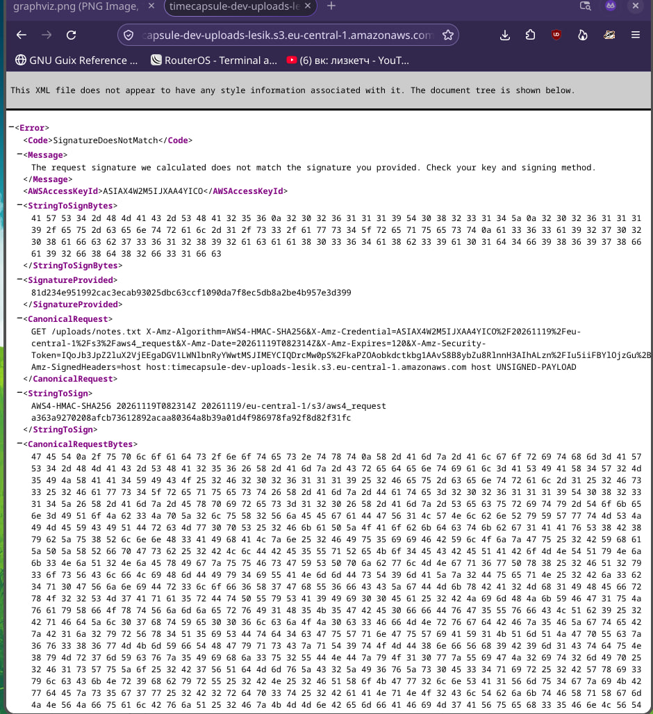
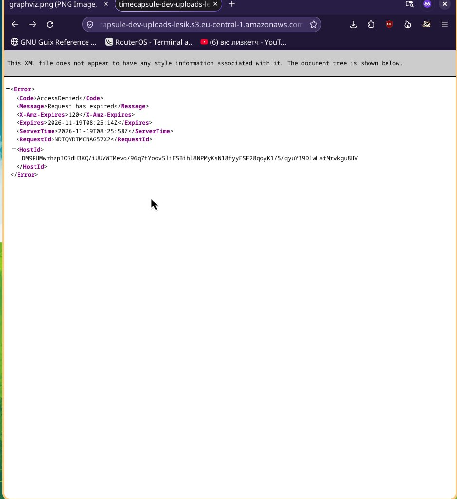

- **Почему нельзя подменить ключ?** Путь объекта и параметры входят в подписываемый запрос. После изменения ключа подпись больше не соответствует запросу, поэтому S3 его отклоняет.
- **Обращается ли `aws s3 presign` к S3?** Подпись создаётся локально из запроса и имеющихся учётных данных, без запроса к S3 для создания ссылки. При этом CLI может обращаться к источнику учётных данных, например к сервису метаданных EC2 или STS, если их нужно получить или обновить.

## Часть 2. Продвинутый уровень

### 7. Политика приложения

Начальная политика `timecapsule-dev-app-s3`, показанная на скриншоте заданий 7–8, разрешает список только под `uploads/` и работу с объектами этого префикса:

```json
{
  "Version": "2012-10-17",
  "Statement": [
    {
      "Sid": "ListUploadsOnly",
      "Effect": "Allow",
      "Action": "s3:ListBucket",
      "Resource": "arn:aws:s3:::timecapsule-dev-uploads-lesik",
      "Condition": {"StringLike": {"s3:prefix": ["uploads/*"]}}
    },
    {
      "Sid": "ManageUploadsObjects",
      "Effect": "Allow",
      "Action": ["s3:GetObject", "s3:PutObject", "s3:DeleteObject"],
      "Resource": "arn:aws:s3:::timecapsule-dev-uploads-lesik/uploads/*"
    }
  ]
}
```

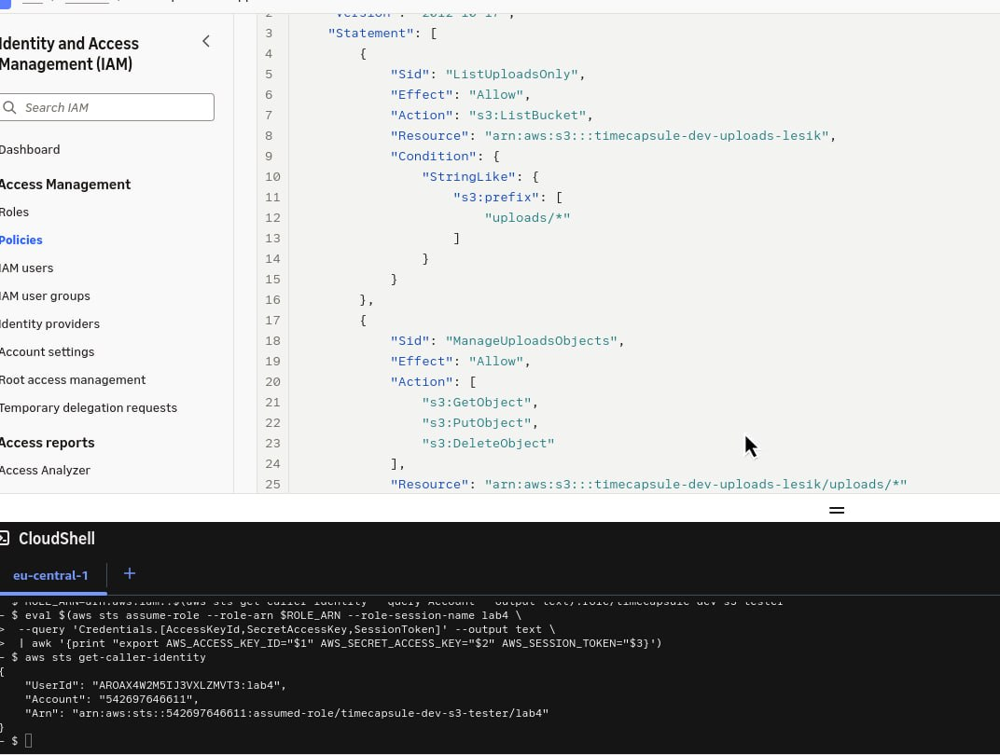

- **Почему используются разные ARN?** `s3:ListBucket` перечисляет содержимое бакета и применяется к ARN самого бакета; условие ограничивает запрашиваемый префикс. `s3:GetObject` действует на конкретный объект, поэтому нужен ARN объекта с соответствующим префиксом.
- **Что будет, если перепутать ARN?** Разрешения не будут подходить к типам ресурсов операций, и запросы не получат необходимого разрешения; редактор IAM также может предупредить о несовместимости действия и ресурса.

### 8. Проверка через тестовую роль

На скриншоте `aws sts get-caller-identity` показывает `assumed-role/timecapsule-dev-s3-tester/lab4`. Отдельного вывода десяти проверок нет, поэтому таблица содержит прогноз для показанной политики, а не неподтверждённые фактические результаты.

| №  | Проверка                                     | Ожидаю         | Получил | Причина ожидаемого результата                |
|----|----------------------------------------------|----------------|---------|----------------------------------------------|
| 1  | Загрузить `uploads/test.txt`                 | Разрешено      | Да      | Разрешение `s3:PutObject`                    |
| 2  | Список `uploads/`                            | Разрешено      | Да      | `s3:ListBucket`, подходящий префикс          |
| 3  | Список корня бакета                          | `AccessDenied` | Нет     | Неявный запрет: пустой префикс не подходит   |
| 4  | Прочитать `uploads/photo.txt`                | Разрешено      | Да      | Разрешение `s3:GetObject`                    |
| 5  | Список `backups/`                            | `AccessDenied` | Нет     | Неявный запрет: префикс не подходит          |
| 6  | Загрузить `backups/test.txt`                 | `AccessDenied` | Нет     | Неявный запрет: ARN вне `uploads/`           |
| 7  | `list-object-versions` для `uploads/`        | `AccessDenied` | Нет     | Неявный запрет: нет `s3:ListBucketVersions`  |
| 8  | Удалить конкретную версию `uploads/test.txt` | `AccessDenied` | Нет     | Неявный запрет: нет `s3:DeleteObjectVersion` |
| 9  | Удалить `uploads/test.txt` без `VersionId`   | Разрешено      | Да      | Разрешение `s3:DeleteObject`                 |
| 10 | Список `uploads/` по HTTP                    | `AccessDenied` | Нет     | Явный `Deny` в политике бакета               |

На более позднем снимке задания 9 `test.txt` присутствует в списке текущих объектов. Поэтому успешное выполнение пункта 9 по предоставленным материалам подтвердить нельзя; возможно, после удаления объект был загружен заново, но это не видно.

- **Чем отличается политика доверия от политики прав?** Политика доверия роли определяет, кому и при каких условиях разрешено принять роль через STS. Политика прав определяет, какие действия над какими ресурсами разрешены уже принятой роли.
- **Что произойдёт с `test.txt` после команды 9?** Если команда выполнена при включённом версионировании, S3 создаст маркер удаления, а предыдущая версия останется. Пользователь с правом удаления маркера сможет её восстановить.
- **Может ли злоумышленник с учётными данными приложения уничтожить файлы без восстановления?** Показанная политика не даёт удалять конкретные версии или изменять lifecycle, поэтому обычное удаление и перезапись сохраняют прежние версии. Это не абсолютная защита: при массовых перезаписях старые версии позже могут быть удалены lifecycle, а сама история увеличит расходы. При `s3:*` на соответствующие ресурсы удаление версий и другие опасные действия могли бы стать доступны; итог также зависит от ресурсной политики и других ограничений.

### 9. Роль сервера

На app-server `aws sts get-caller-identity` показывает сессию `assumed-role/timecapsule-dev-app-role/...`. Список `uploads/` разрешён, а запрос списка `backups/` возвращает `AccessDenied`.

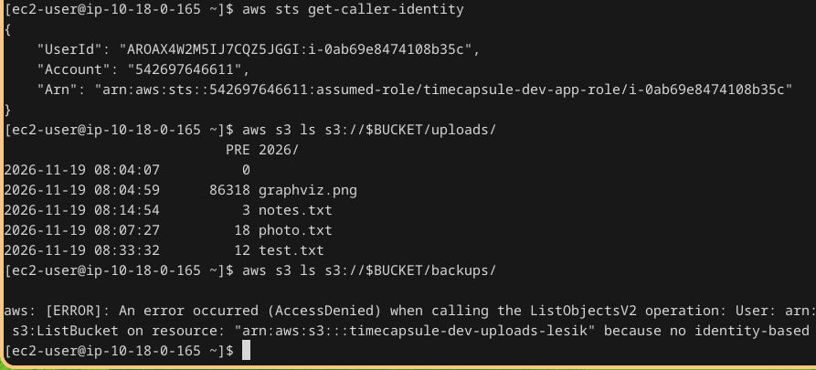

- **Откуда взяты учётные данные?** EC2 через instance profile предоставляет временные учётные данные роли в сервисе метаданных IMDS; AWS CLI находит их в стандартной цепочке источников и обновляет по мере необходимости.
- **Чем отличается политика доверия?** Серверная роль доверяет сервису `ec2.amazonaws.com`, который принимает её для экземпляра. Тестовая роль доверяет указанному AWS-аккаунту, а конкретному пользователю этого аккаунта дополнительно требуется право `sts:AssumeRole`.
- **Почему роль безопаснее ключа в `.env`?** Временные ключи автоматически обновляются и имеют ограниченный срок, их не нужно хранить в файле или передавать вместе с кодом. Доступ к IMDS и разрешения роли всё равно нужно ограничивать: временные credentials также можно украсть и использовать до истечения срока.

### 10. Перенос существующих файлов

На скриншоте `--dryrun` показал загрузку `storage/uploads/.gitkeep`, затем `sync` её выполнил, а повторный `--dryrun` не вывел изменений. Команда запускалась из `/var/www/timecapsule`, а не из указанного в задании `/var/www/timecapsule/current`.

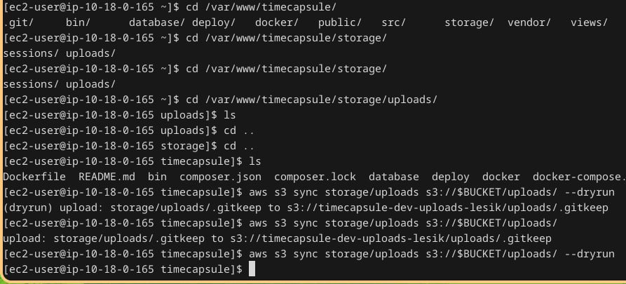

Подтверждён перенос только `.gitkeep`: снимок не доказывает перенос старых пользовательских вложений или проверку их `Content-Type`. Если старые вложения находятся в другом каталоге или на другом сервере, нужно найти их и повторить миграцию из фактического каталога.

- **Хватило ли прав для `sync`?** Для показанной загрузки — да: команда перечислила объекты целевого префикса с помощью `s3:ListBucket` и загрузила файл с помощью `s3:PutObject`. `s3:GetObject` и `s3:DeleteObject` для показанной локальной синхронизации без `--delete` не требуются; другие режимы `sync` могут использовать иные права.

### 11. Модуль хранения на S3

Для варианта PHP Functional модуль хранения — [`src/storage.php`](../../src/storage.php). Целевое решение: `storage_save()` вызывает `PutObject` с `SourceFile` и определённым MIME-типом, `storage_delete()` вызывает `DeleteObject`, а `storage_stream()` после проверки доступа к капсуле отдаёт HTTP 302 на URL для `GetObject`, подписанный на пять минут. В подписанный запрос включаются `ResponseContentType` и `ResponseContentDisposition`, чтобы сохранить способ отображения и исходное имя.

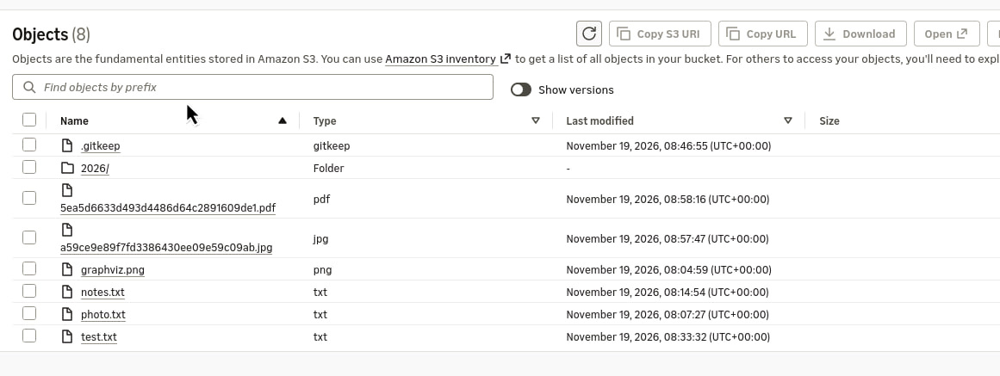

На снимке в бакете видны PDF и JPG со случайными именами.

### 12. Деплой и проверка

На снимке задания 11 видны новые объекты PDF и JPG в `uploads/`; на снимке ниже в адресной строке показан адрес объекта PDF на региональном S3 endpoint. Полная подписанная ссылка в отчёте не публикуется.

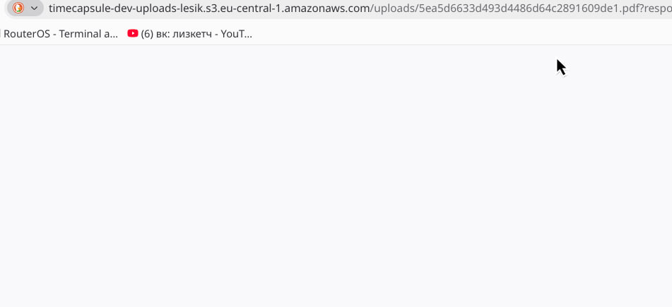

Снимки не подтверждают заголовки `Content-Type`, скачивание PDF под исходным именем, старое вложение, ответ через пять минут и маркер после удаления капсулы. Адресная строка обрезана, поэтому сами параметры подписи и результат открытия PDF тоже не видны; эти проверки нужно выполнить и зафиксировать отдельно.

- **Почему ссылку не нужно специально отзывать?** Подписанный URL автоматически прекращает действовать по истечении заданного срока или раньше, если истекли временные учётные данные либо доступ отозван. До этого момента любой обладатель ссылки может ею воспользоваться, поэтому её передача другу даёт ему временный доступ.
- **Что остаётся после удаления капсулы и когда исчезнет?** При обычном `DeleteObject` остаются delete marker и неактуальные версии вложения. По правилу задания версии старше 90 дней удаляются лишь при превышении числа сохраняемых новейших версий: последние две могут остаться бессрочно; маркер также не обязан исчезнуть по показанному правилу. Для полного удаления нужны отдельные подходящие действия lifecycle или удаление версий и маркера уполномоченным пользователем.

### 13. Сервер без состояния

На снимке CloudShell запрос несуществующего `uploads/no-such-file.txt` возвращает `404 Not Found` в операции `HeadObject`. Результат такого же запроса на сервере, отказ `ls` после удаления `ListBucket` и работа приложения без локальной папки на предоставленных снимках не показаны.

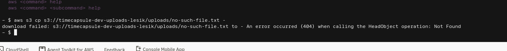

- **Почему ответы могут отличаться?** S3 возвращает `404`, если объект отсутствует и вызывающему разрешено `s3:ListBucket` для соответствующего запроса. Без этого разрешения вместо подтверждения отсутствия объекта возвращается `403 AccessDenied`; это не позволяет пользователю без права перечисления выяснять существование ключей.
- **Что нужно для замены app-server?** Поднять новый экземпляр с приложением и зависимостями, настроить доступ к базе и бакету, привязать IAM-роль и подключить его к сети и точке входа. Вложения переносить с диска старого сервера не потребуется только после подтверждённого переноса всех файлов в S3 и перехода приложения на S3; сессии и другие данные, зависящие от локального диска, также нужно сохранить или вынести из экземпляра.

### 14. Архитектура и решение

На целевой схеме S3 находится внутри региона, но вне VPC. Приложение обращается к нему по HTTPS с правами IAM-роли, а браузер скачивает вложение напрямую по подписанному URL. Подсети и база взяты из ЛР3; IP app-server `10.18.0.165` виден на снимках ЛР4. Расположение bastion показано по схеме ЛР3 и требует сверки с фактической конфигурацией.

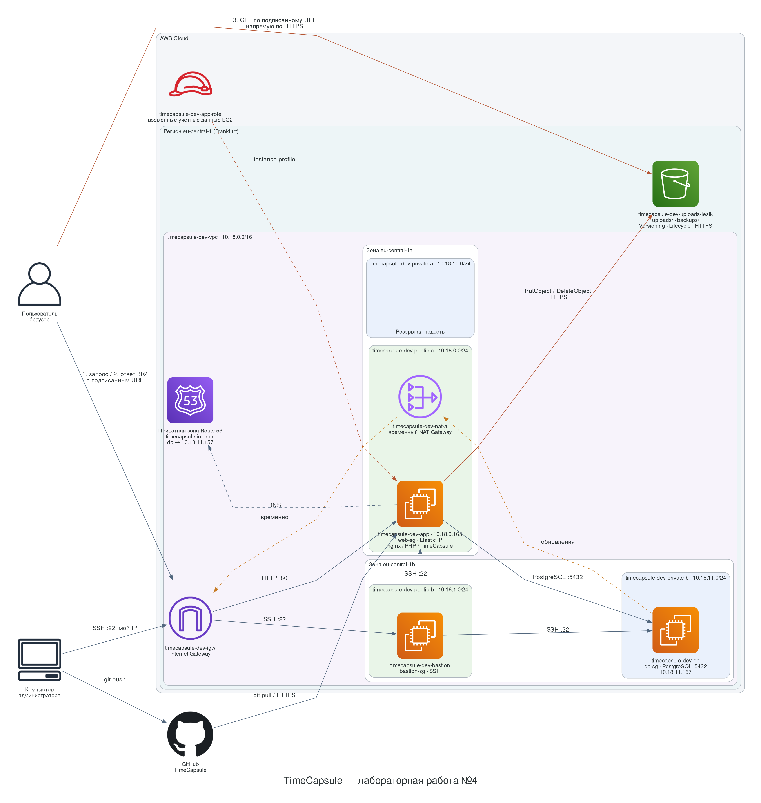

[Исходник схемы diagrams и Graphviz](architecture.py) · [ADR-0003: хранение вложений](../adr/0003-attachment-storage.md)

## Дополнительные вопросы для защиты

1. **'Как проходит скачивание и где проверяются права?** Браузер запрашивает вложение у приложения; приложение проверяет пользователя и доступность капсулы и выдаёт перенаправление на подписанный URL. Браузер обращается к S3 напрямую, а S3 проверяет подпись и права учётных данных роли, которыми подписан запрос; пользователя приложения S3 не знает.
2. **Что защищает прямой адрес объекта?** Бакет не должен разрешать публичное чтение, а Block Public Access дополнительно предотвращает публичные разрешения. Прямой неподписанный URL не содержит доказательства прав; подписанный URL действует только для определённого запроса и ограниченного срока, причём его обладатель может пользоваться им до истечения.
3. **Почему подписанный URL, а не публичный бакет?** Приложение может проверить доступ к конкретной капсуле перед выдачей краткосрочной ссылки. Публичный бакет позволил бы обращаться к объектам без этой проверки; подписанный URL при этом не требует проксировать содержимое файла через app-server.
4. **Как пережить отказ региона?** Понадобятся второй регион, настроенная межрегиональная репликация S3 и проверенная процедура переключения на реплику; репликация обычно асинхронна, поэтому последние изменения могут не успеть скопироваться. Для восстановления всего приложения также нужны работоспособные серверы, репликация или резервные копии базы, маршрутизация и необходимые IAM-настройки во втором регионе.

## Вывод

Рассмотрены работа с объектами S3, политика HTTPS, версии, lifecycle, подписанные URL и ограничение доступа IAM. Скриншоты подтверждают ряд базовых операций, получение роли сервером, загрузку тестовых объектов и создание S3-адреса. Для полного подтверждения продвинутого уровня остаются исправление lifecycle, проверка таблицы прав и недостающих сценариев, подтверждение переноса старых вложений и публикация реализации S3 в репозитории.
