# Лабораторная работа №5. Облачные базы данных. Amazon RDS

**ФИО:** Пустовой Алексей
**Группа:** IA2404
**Уровень:** продвинутый · **Регион:** `eu-central-1`

**Цель:** проверить репликацию и восстановление в RDS, затем перенести базу TimeCapsule с EC2. Инфраструктуру описал в [OpenTofu](tofu/).

## Часть 1. Учебная база

### 1. Сеть

В `lab5-db-subnets` добавил `private-a` и `private-b`. Вход на 5432 разрешил только от `lab5-web-sg`, которую временно добавил к `timecapsule-dev-app`.

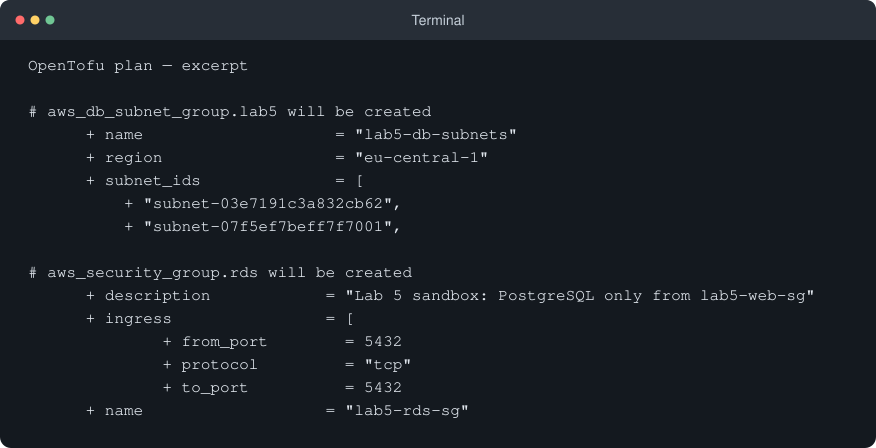

### 2. Учебная RDS

Создал `lab5-db` в `eu-central-1a`, с шифрованием, защитой от удаления и без публичного доступа. AWS Free отклонил 7 дней хранения копий, поэтому указал **1 день**. [Успешный `apply`](evidence/04-apply-free.txt)

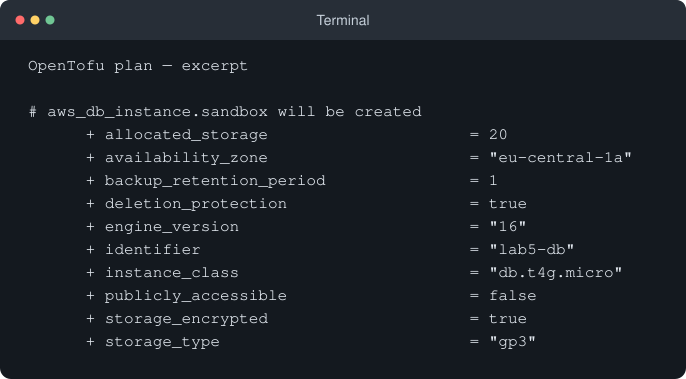

### 3. Подключение с app-server

Подключился по TLS 1.3, создал `notes` и прочитал три строки. DNS вернул приватный IP, но с bastion без нужной SG подключение не прошло.

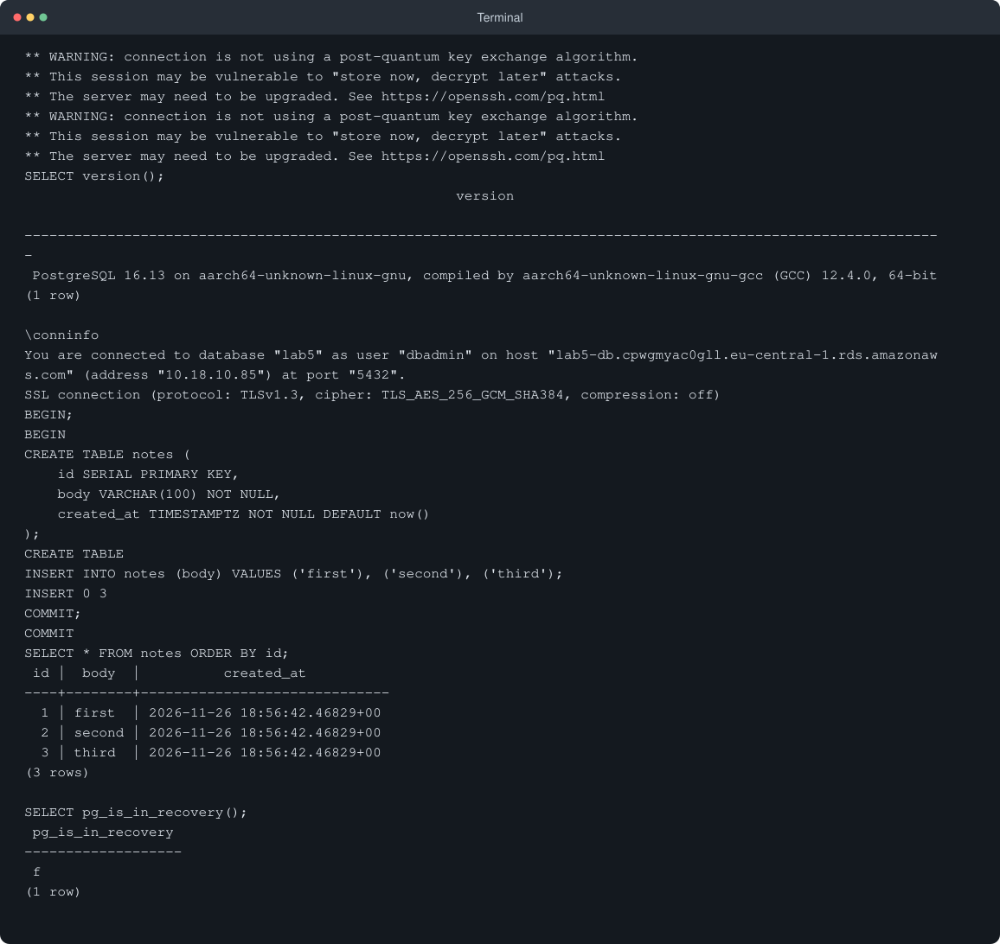

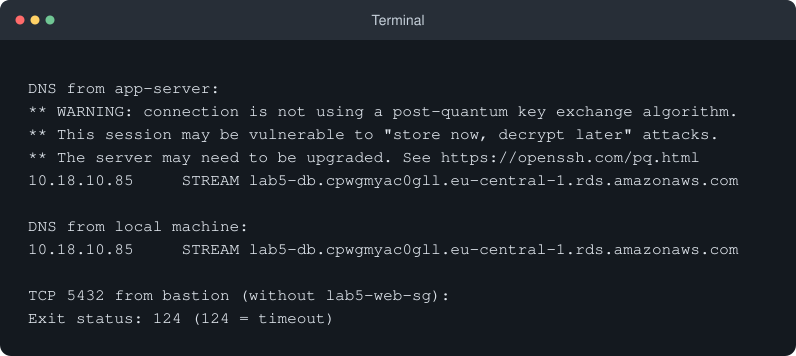

### 4. Реплика

На реплике в `eu-central-1b` `pg_is_in_recovery()` вернул `t`, на основной БД — `f`. Реплика не приняла `INSERT`, но прочитала `fourth`, добавленную на основной БД. `ReplicaLag` снизился с 270 до 30 секунд.

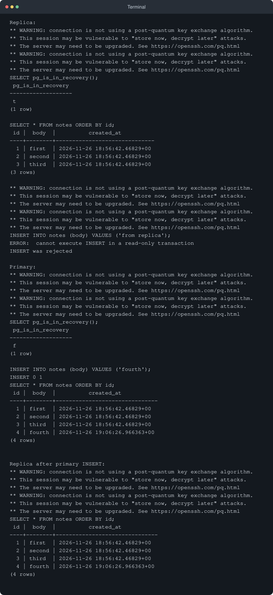

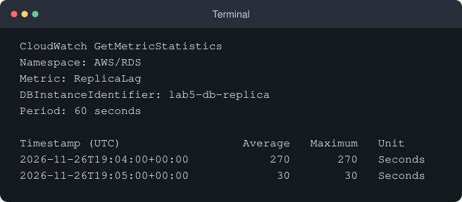

### 5. Восстановление

Удалил четыре строки — реплика тоже стала пустой. Восстановил `lab5-db-restore` на `19:07:05 UTC`, до `DELETE`. В копии снова появились все четыре строки.

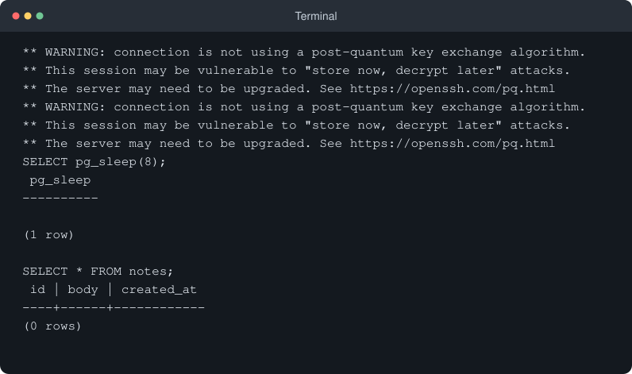

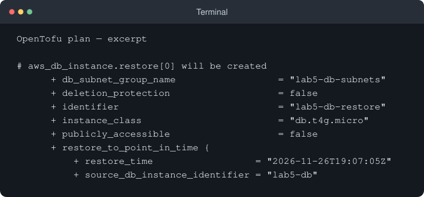

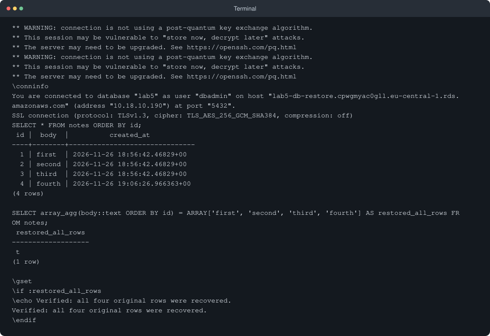

После проверки удалил учебный стек.

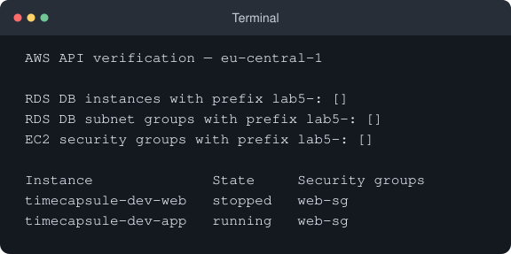

## Часть 2. База TimeCapsule

### 6. RDS для приложения

Создал приватную `timecapsule-dev-rds`: PostgreSQL 16.13, `db.t4g.micro`, 20 ГиБ gp3, Single-AZ и копии на 1 день.

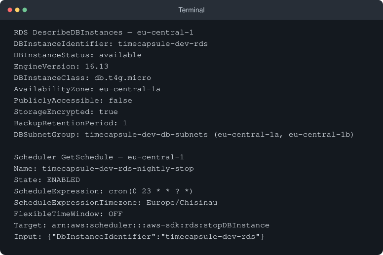

### 7. Ночная остановка

Scheduler остановил БД в 21:52. После теста вернул расписание на **23:00 по Кишинёву**.

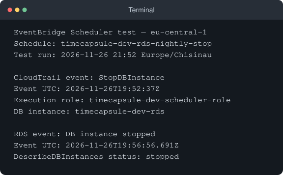

### 8–9. Пользователь, база и перенос данных

Создал роль и БД `timecapsule`. На время `pg_dump` и `pg_restore` остановил nginx. Количество и содержимое строк совпали: **2 пользователя, 2 капсулы, 4 уведомления**. Дамп удалил.

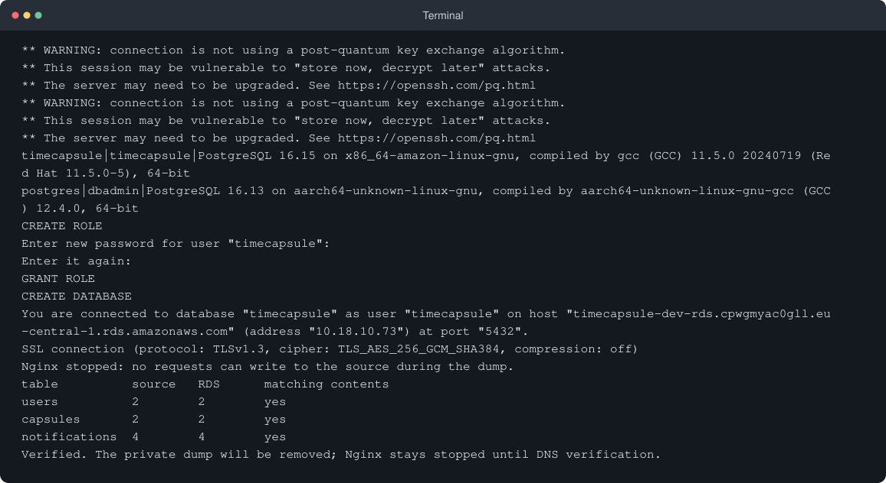

### 10. Переключение приложения

Заменил A на CNAME и дождался истечения кэша. PHP подключился к RDS по TLS, `/health` вернул `200`. Через приложение создал капсулу №3 и нашёл её в RDS.

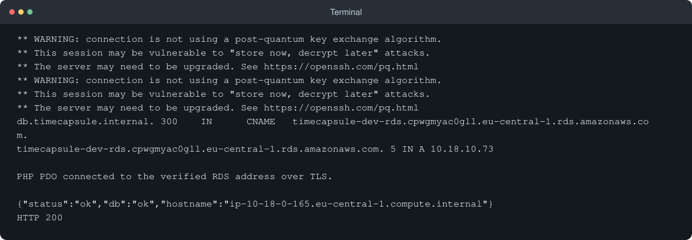

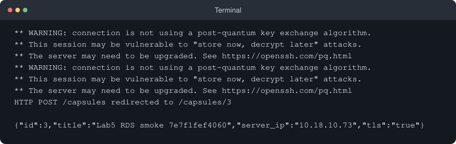

Старый EC2 оставил остановленным вместе с диском. [Без старой БД `/health` вернул `200`](evidence/41-confirmed-legacy-off-health.txt).

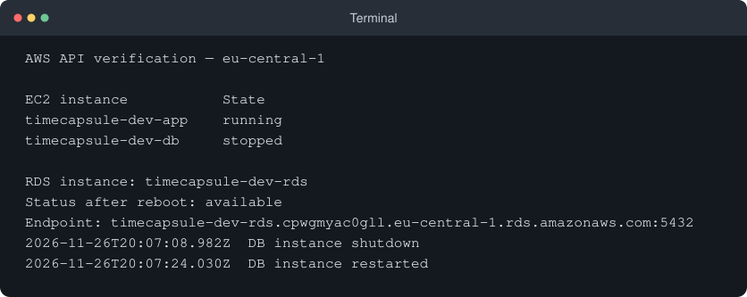

### 11. Обслуживание

При перезагрузке `/health` показал `200 → 500 → 200`. При ручной остановке RDS `/health` вернул `500`, после запуска — `200`. Endpoint не изменился.

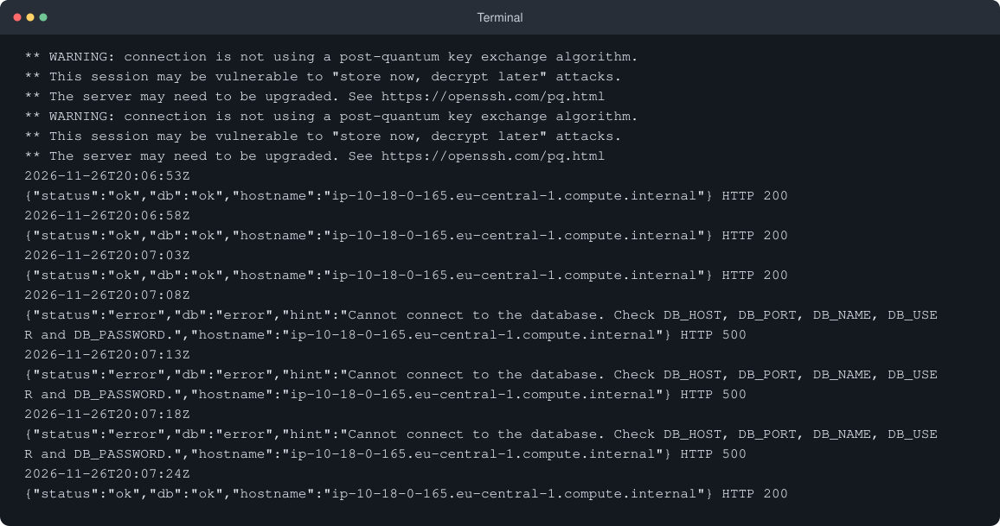

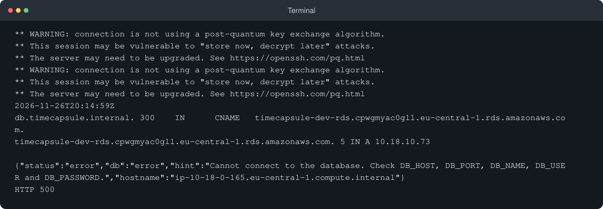

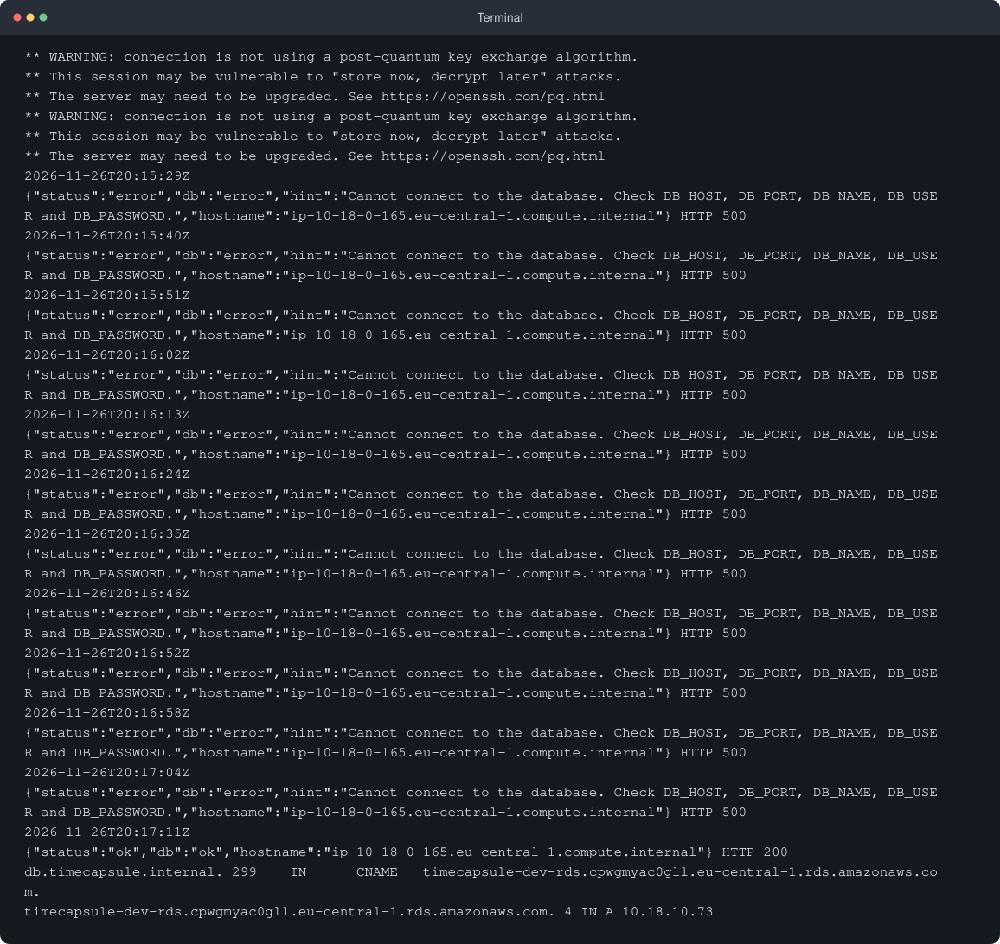

**Итог:** AWS подтвердил `stopped` в 20:27:26 UTC. Расписание осталось включено на 23:00 по Кишинёву. Пока RDS остановлена, `/health` не проходит; перед работой нужно запустить БД.

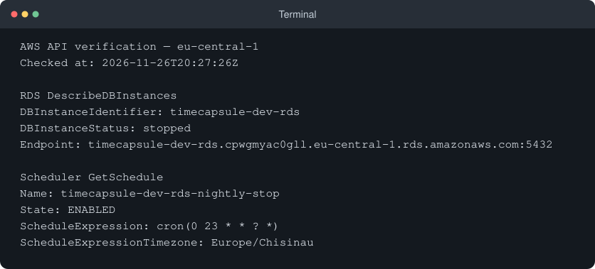

### 12. Архитектура

[ADR-0004: выбор места для базы](../adr/0004-database-hosting.md) · [Скрипт схемы](architecture.py)

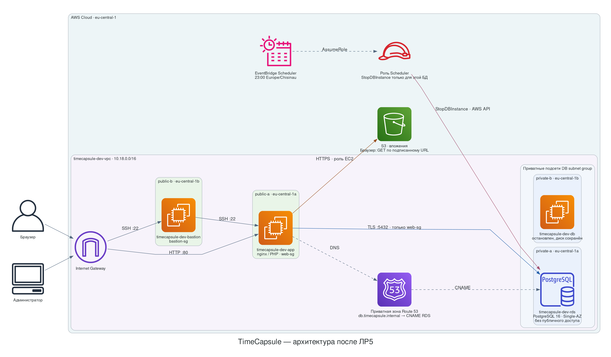

## Контрольные вопросы

- **Почему SG вместо IP и зачем две подсети?** Правило привязано к группе, поэтому смена IP сервера его не ломает. RDS требует подсети в разных AZ; это не превращает Single-AZ в Multi-AZ.
- **Почему `eu-central-1a` и что защищает deletion protection?** Основную БД разместил в `1a`, чтобы показать реплику в `1b`. Защита запрещает удалить экземпляр, но не мешает удалить строки или таблицы через SQL.
- **Реплика, Multi-AZ и PITR.** Реплика доступна для чтения и повторяет даже ошибочный `DELETE`. Standby обычного RDS Multi-AZ нужен для автоматического переключения, а PITR создаёт отдельную БД до ошибки и не меняет источник.
- **Что изменил бы для рабочей системы?** Включил бы Multi-AZ, мониторинг и регулярную проверку восстановления, а класс экземпляра выбрал бы по нагрузке. Ночную остановку убрал бы, потому что приложение должно работать круглосуточно.
- **Зачем отдельные роли?** Scheduler не использует мои права: его IAM-роль разрешает остановить только одну RDS. Роль PostgreSQL `timecapsule` даёт приложению доступ к своей БД без прав `dbadmin`.
- **Почему не менялся `DB_HOST` и что обслуживает AWS?** Имя прежнее, изменилось только назначение записи DNS. AWS обслуживает экземпляр и делает копии; за доступы, схему и проверку восстановления отвечаю я.
- **Как запрос доходит до БД?** Браузер обращается к nginx, затем PHP разрешает приватное имя в Route 53. В RDS запрос проходит через SG на 5432, а PostgreSQL проверяет подключение и права роли `timecapsule`.
- **Что при отказе зоны и после семи дней остановки?** Single-AZ не переключается автоматически: надо восстановить БД в другой зоне и обновить CNAME. AWS сам запускает БД через семь дней остановки, а Scheduler снова остановит её вечером; вызов для уже остановленного экземпляра возвращает `InvalidDBInstanceState`.
