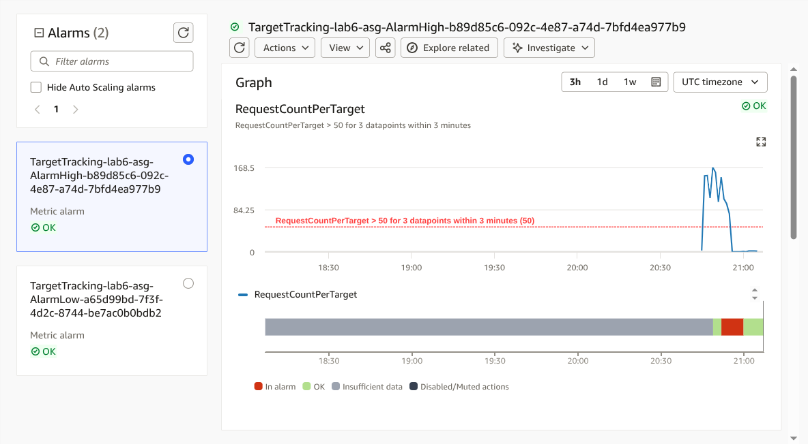
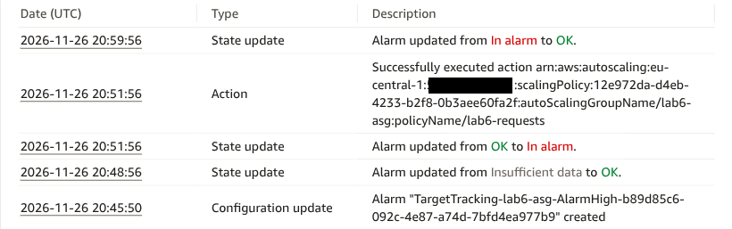
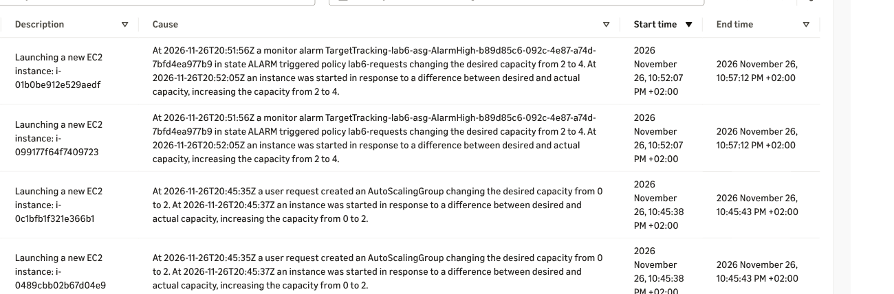
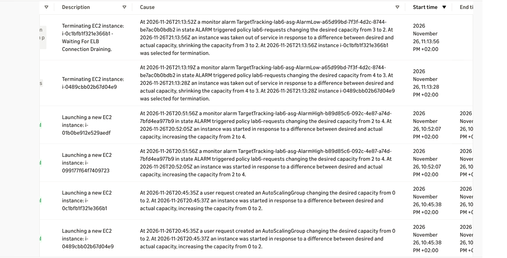
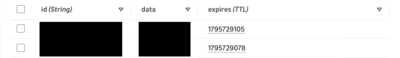
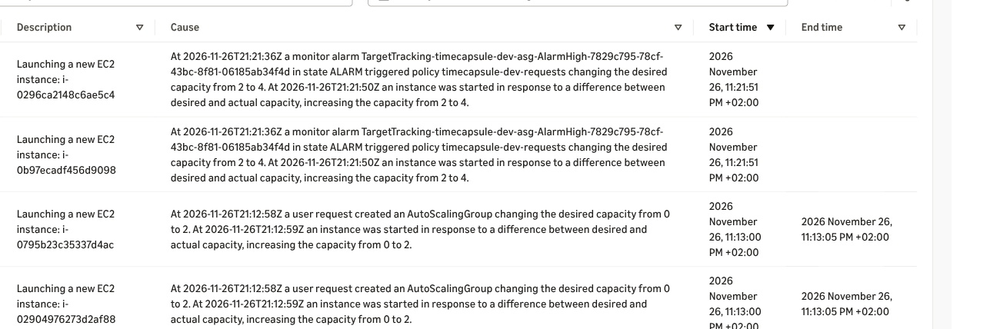
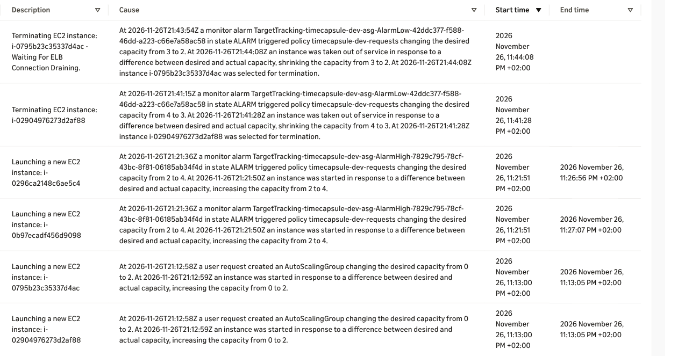
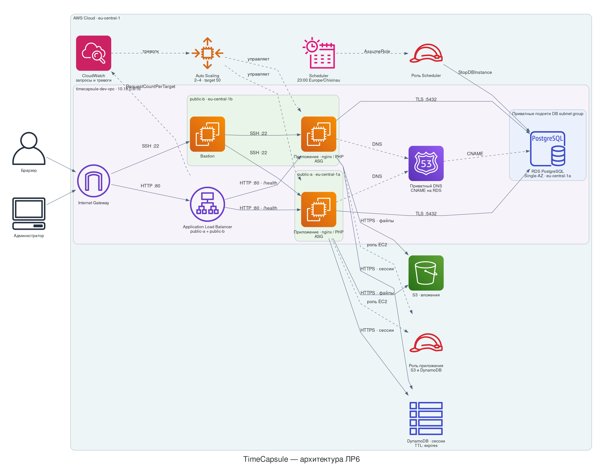

# Лабораторная работа №6. Масштабирование и балансировка нагрузки

**ФИО:** Пустовой Алексей  
**Группа:** IA2404 · **Специальность:** прикладная информатика  
**Уровень:** продвинутый · **Регион:** `eu-central-1`  
**Репозиторий:** [timecapsule](https://github.com/LesikAWSLabsAAAAAA/timecapsule)

**Цель:** настроить балансировку запросов и автомасштабирование EC2, затем перенести сессии приложения в общее хранилище. Конфигурация ресурсов — в [OpenTofu](tofu/).

> Браузер блокировал HTTP-адреса (`ERR_BLOCKED_BY_CLIENT`), поэтому ответы серверов и вход в приложение проверялись HTTP-клиентом. Скриншотов этих проверок нет.

## Часть 1. Учебный nginx

Для nginx настроены целевая группа `lab6-tg` и балансировщик `lab6-alb` в двух публичных подсетях. Проверка `/health` выполнялась каждые 10 секунд. Группа `lab6-asg` запускала от двух до четырёх серверов AL2023; target tracking был настроен на 50 запросов в минуту на сервер. HTTP на серверы разрешён только от ALB, SSH — от bastion.

После запуска обе первоначальные цели были `healthy`, ответы содержали разные имена серверов и зоны. Во время нагрузки группа увеличилась с **2 до 4**; на скриншоте уже четыре исправные цели.

После снижения нагрузки AlarmLow уменьшил желаемое число серверов обратно до двух. На скриншоте история показывает и добавление серверов, и начавшееся удаление лишних.

После возвращения группы к двум экземплярам учебный стек удалён через `tofu destroy`: всего 8 ресурсов. ASG и `lab6-alb` больше нет.

## Часть 2. Приложение

Для сессий создана таблица `timecapsule-dev-sessions` с ключом `id` и TTL `expires`. Режим оплаты — on-demand. К роли приложения прикреплена политика доступа к таблице, а обновлённый `bootstrap.php` скопирован на `timecapsule-dev-app` через `scp`. Запись и чтение тестовой сессии прошли успешно.

Из `timecapsule-dev-app` создан AMI, по которому запущена группа приложения. При проверке через ALB 20 запросов одной сессии распределились поровну между двумя серверами, вход при этом сохранился. Также создана тестовая капсула №4 и открыта её страница.

Во время первого запуска Scheduler из ЛР5 остановил RDS по расписанию, и `/health` вернул ошибку. Группа была временно удалена, а база запущена повторно. После этого `/health` ответил `200`, а под нагрузкой AlarmHigh увеличил группу с двух до четырёх серверов.

После снижения нагрузки AlarmLow уменьшил группу с четырёх серверов до двух. Во время 20-минутной проверки одной сессии ответы пришли от четырёх разных серверов; вход сохранялся на каждом из них.

После испытания `timecapsule-dev-app` остановлен, его Elastic IP освобождён. Балансировщик и группа приложения удалены; таблица, политика, AMI, шаблон запуска и целевая группа оставлены. В `eu-central-1` нет запущенных EC2, балансировщиков, ASG и выделенных Elastic IP; RDS остановлена. Хранилище RDS и снимок AMI продолжают тарифицироваться.

### Архитектура

ALB принимает HTTP из интернета и направляет запросы к исправным экземплярам в двух зонах. Серверы читают сессии из DynamoDB, сохраняют вложения в S3 и подключаются к RDS по TLS. В RDS разрешён порт 5432 от группы безопасности серверов; SSH к серверам разрешён от bastion. База Single-AZ, поэтому две зоны приложения не обеспечивают автоматическое восстановление самой БД при отказе её зоны.

[ADR-0005: выбор хранилища сессий](../adr/0005-session-storage.md).

## Ответы на вопросы

**Что вернёт ALB без исправных целей и зачем две зоны?** Без доступных зарегистрированных целей ALB отвечает `503 Service Unavailable`: запрос некуда передать. Для интернет-балансировщика нужны подсети минимум в двух зонах; такое размещение также помогает продолжать обслуживание при отказе одной зоны.

**Чем ASG отличается от target group и почему в шаблоне нет подсети?** ASG управляет количеством и жизненным циклом EC2, а target group содержит цели, на которые ALB направляет трафик, и проверяет их работоспособность. Подсети заданы группе, чтобы она выбирала размещение серверов по зонам; шаблон при этом можно использовать независимо от конкретной подсети.

**Почему группа выросла не больше четырёх и почему метрика уменьшается?** Политика запросила дополнительные серверы из-за AlarmHigh, но ограничение `max_size` равно четырём. При том же общем количестве запросов на каждый здоровый сервер приходится меньшая доля запросов. Уменьшение группы обычно происходит осторожнее: нужна устойчивая низкая нагрузка, иначе возможны частые колебания числа серверов.

**Почему не оставить сессии в файлах?** Файл существует только на одном сервере; другой сервер не найдёт ту же сессию, а при удалении экземпляра файл пропадёт. DynamoDB делает данные сессии общими для всех экземпляров; cookie при этом хранит идентификатор сессии, а не всю сессию.

**Зачем Node.js параметр `initialized: true`?** Он сообщает библиотеке, что таблица уже создана и инициализирована, поэтому повторно создавать её не нужно. В данной работе используется PHP, а не Node.js.

**Почему Elastic IP больше не нужен для приложения?** Пользователь обращается к DNS-имени ALB, а не к адресу отдельного EC2. ALB направляет запросы зарегистрированным экземплярам; сам Elastic IP при этом необходимо отдельно отвязать и освободить, если он больше не нужен.

**Пришлось ли войти заново во время масштабирования?** В проверке одной сессии вход сохранился при смене серверов и уменьшении группы. Каждый сервер использовал одну таблицу DynamoDB, поэтому состояние входа не зависело от локального диска выбранного экземпляра.

**Почему у серверов одинаковые `.env` и секреты?** Каждый сервер запускается из одного AMI, то есть получает копию файловой системы исходного сервера на момент создания образа. Это удобно для лабораторной, но секреты оказываются в образе и на всех копиях диска; в рабочей системе их лучше выдавать через управляемое хранилище секретов.

**Что будет с `/health`, если остановить базу?** Обработчик делает запрос к таблице `users`; при недоступной БД он возвращает HTTP 500. Цели перестают проходить проверку ALB, а ASG при включённых ELB health checks может заменять их, хотя перезапуск серверов сам по себе не восстановит базу.

**Как проходит запрос?** Браузер обращается к DNS ALB, балансировщик выбирает цель, а PHP читает или сохраняет сессию в DynamoDB через IAM-роль. Данные капсул находятся в RDS, а вложения — в S3.

**Чем отличаются проверки ALB и ASG?** ALB регулярно проверяет endpoint и использует результат при маршрутизации. ASG поддерживает нужную ёмкость и при включённых ELB health checks может заменить сервер, признанный неисправным.

**Что будет при отказе зоны `eu-central-1a`?** ALB может направлять запросы на исправные экземпляры в другой зоне, а ASG попытается восстановить ёмкость в доступных подсетях. Однако RDS здесь Single-AZ в `eu-central-1a`; автоматического переключения базы в другую зону нет, поэтому приложение может остаться недоступным до её восстановления.
