# Лабораторная работа №7. Бессерверные вычисления и события

**ФИО:** Пустовой Алексей

**Группа:** IA2404 · **Специальность:** прикладная информатика

**Уровень:** продвинутый · **Регион:** `eu-central-1`
**Репозиторий:** [timecapsule](https://github.com/LesikAWSLabsAAAAAA/timecapsule)

**Цель:** связать издателей и обработчики с помощью SNS и SQS, вынести
медленные уведомления и открытие капсул из веб-запроса в Lambda.
Ресурсы описаны в [OpenTofu](tofu/); терминальные изображения построены
из сохранённого фактического вывода, как в ЛР5. Номера аккаунта и адрес
почты в опубликованных материалах скрыты.

## 1. Тема и очередь отзывов

Созданы стандартная тема `lab7-reviews`, `lab7-reviews-queue`,
`lab7-reviews-dlq`, подписка очереди и Lambda `lab7-review-worker`.
Очередь получила опубликованный `r-1` в виде JSON-тела отзыва без оболочки:
включена raw message delivery. Без неё SQS получил бы JSON-оболочку SNS,
где строка `Message` содержит исходный JSON.

Выбраны timeout функции 10 с, visibility timeout 60 с (шестикратный запас),
хранение исходной очереди четыре дня, DLQ — 14 дней, `maxReceiveCount = 3`
и пачка из одного сообщения. Длительное хранение DLQ оставляет время на
разбор сбоя; пакет из одного сообщения изолирует ошибки. Получение само по
себе не удаляет сообщение: через visibility timeout оно становится видимым
снова, если потребитель не подтвердил обработку удалением.

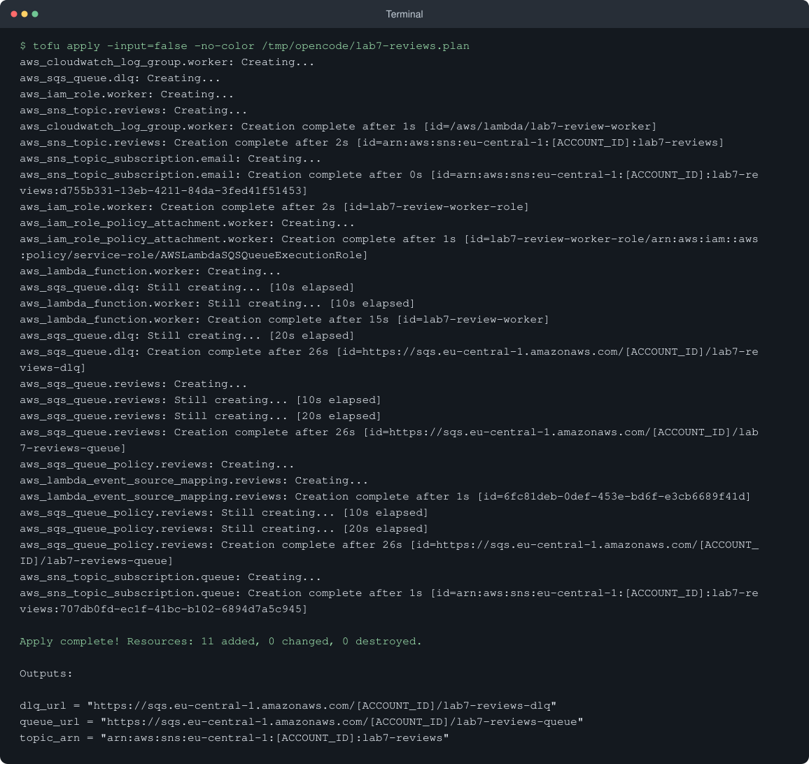

В конце части все 11 созданных ресурсов удалены; последующая проверка SNS,
SQS и Lambda не обнаружила ресурсов с префиксом `lab7-`.

## 2–3. Обработка, ошибка и DLQ

В CloudWatch зафиксированы строки `r-2: 3/5 Delivered on time`,
`r-3: 1/5 Item was damaged`, `r-5: 5/5 Excellent product`. При пачке
размером один они обработаны тремя отдельными вызовами; при больших пачках
число вызовов зависит от количества пришедших сообщений и настроек batching.

Исходная функция требовала поле `text`. Для `r-4` без текста в журнале
наблюдались три `KeyError`, затем отзыв появился в DLQ. После исправления
обработчика и `StartMessageMoveTask` в журнале появилась строка `r-4: 4/5`.
Повторы определяются `maxReceiveCount` и временем видимости; сообщение
попадает в DLQ после нескольких неуспешных получений, а не сразу.
При обычной обработке пачки из десяти без partial batch response одна ошибка
возвращает всю пачку и успешные записи могут быть обработаны повторно.

## 4. Фильтрация почты

На **email-подписке**, а не на подписке очереди, задан числовой фильтр
`rating < 3`. Проверены четыре события:

| Атрибут | Почта | Журнал |
| --- | --- | --- |
| `rating = 1` | доставлен | есть |
| `rating = 3` | фильтруется | есть |
| `rating = 5` | фильтруется | есть |
| атрибут отсутствует | фильтруется | есть |

В журнале есть все четыре тестовых отзыва; письмо с плохим отзывом видно в
почте. Для остальных строк почтовой колонки указано действие фильтра, а не
независимое доказательство отсутствия письма. Без атрибута условие подписки
не выполняется. При прямой рассылке в отдельные очереди добавление аналитики
потребовало бы изменения издателя; SNS позволяет добавить подписчика отдельно.

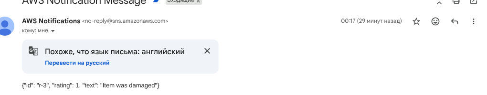

## 5–7. События и уведомления TimeCapsule

Созданы тема `timecapsule-dev-events`, очередь `timecapsule-dev-mail` и её DLQ,
функция `timecapsule-dev-mailer`, подписка с фильтром тела и роли. Схема
событий приведена в [events.md](../events.md): `capsule.sealed` передаёт
только идентификатор, а адрес и текст берутся из RDS; содержимое капсулы и
секреты в событие не включаются.

Lambda работает в приватных подсетях с доступом к RDS по TLS, без исходящего
доступа в интернет. Служба Lambda читает SQS от имени роли. Время функции —
30 с, visibility timeout — 180 с, хранение очереди — четыре дня, DLQ —
14 дней, `maxReceiveCount = 3`, пачка — одно сообщение. Параллелизм
потребителя ограничен двумя вызовами через event source mapping, чтобы не
перегружать RDS. Резервирование concurrency было отклонено из-за квоты
учебного аккаунта; исправление показано в выводе OpenTofu.

Дважды отправлено одинаковое событие для тестовой капсулы №6: в базе создана
одна строка уведомления. Защиту обеспечивает уникальный частичный индекс
по `capsule_id` для уведомлений о запечатывании; он установлен после проверки
отсутствия старых дубликатов. Индекс зависит от прежнего формата текста
уведомления; для развития приложения лучше выделить тип уведомления в столбец.

Роль сервера получила право `sns:Publish` только для темы. На вкладке
сетевого мониторинга браузера измерен POST `Seal capsule`: **3321 мс до**
и **377 мс после** изменения, оба ответа — HTTP 302. Это отдельные измерения,
а не статистическая оценка задержки. [Данные сетевого захвата](evidence/10-network.csv)
сохранены из Chrome DevTools Protocol; скриншоты самой вкладки Network не
снимались. При сбое mailer пользователь всё равно
получает успешный ответ после публикации, сообщение остаётся в SQS и затем
может попасть в DLQ.

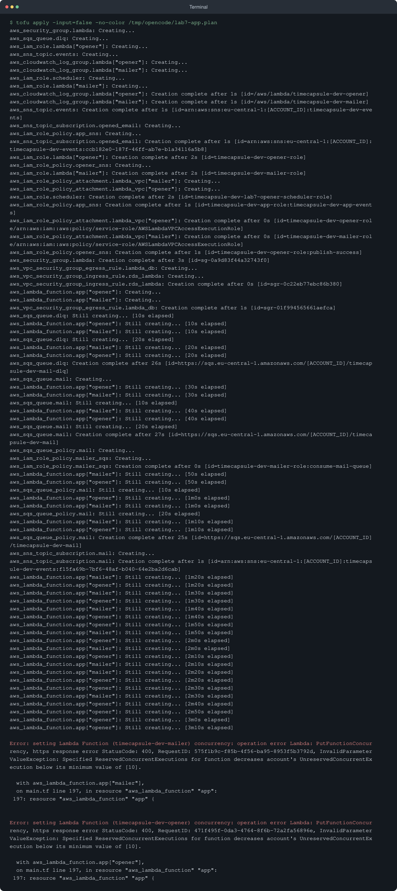
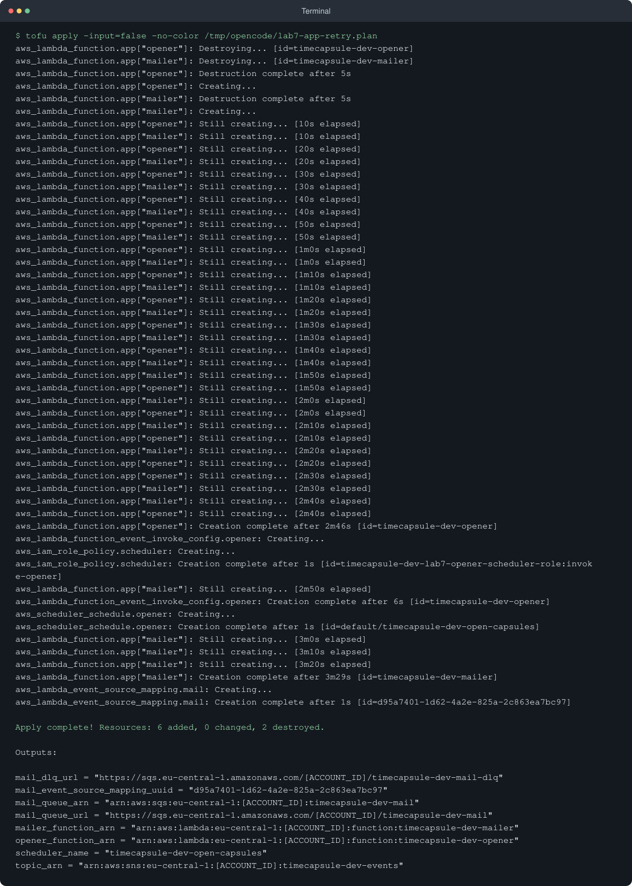

## 8. Открытие по расписанию

EventBridge Scheduler вызывает `timecapsule-dev-opener` раз в минуту.
Функция в одной транзакции открывает наступившие капсулы и добавляет
уведомления в RDS. Успешный асинхронный результат отправляет служба Lambda
в SNS через success destination; сама функция SNS не вызывает. Email-подписка
фильтрует `responsePayload.eventType = capsules.opened`, поэтому пустые
результаты не отправляются пользователю.

Капсула №7 была создана с открытием на 22:46 UTC. После наступления времени
БД показала состояние `opened` и два уведомления — о запечатывании и открытии;
по почте пришла запись SNS с `openedCount: 1`. Открытие не зависит от
веб-запроса. Код Lambda не обращается к SNS через VPC; для прямого вызова
потребовался бы сетевой выход, например платный NAT Gateway или интерфейсный
VPC endpoint. Расписание менее точно: событие может запоздать на интервал
расписания и время выполнения.

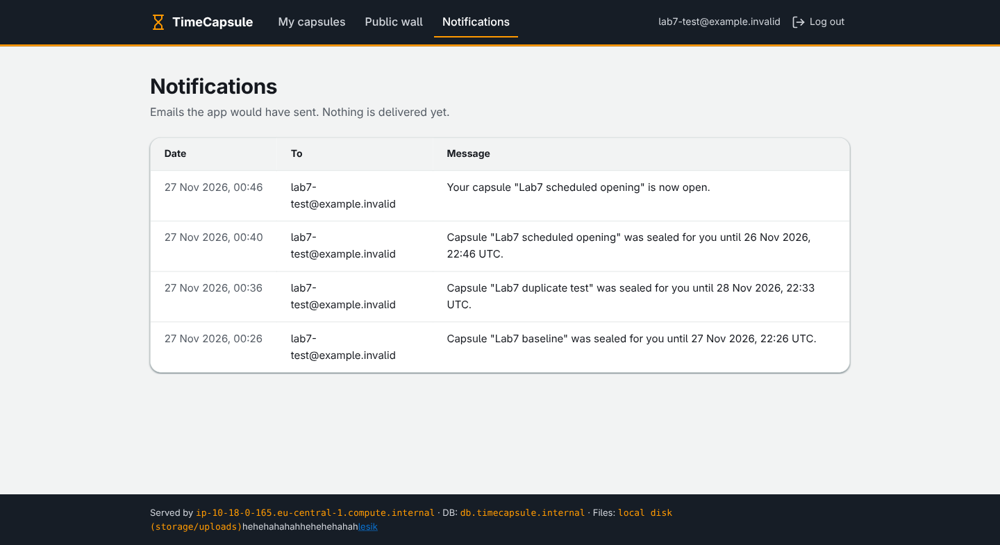
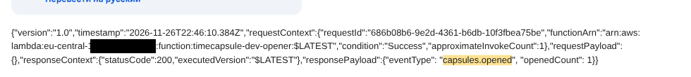
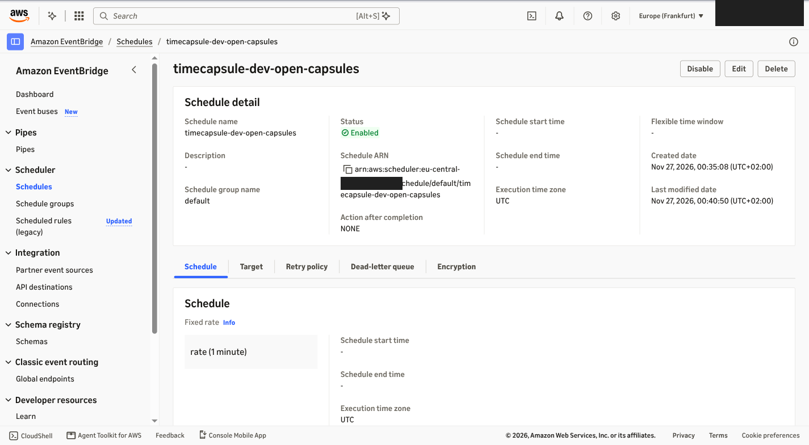
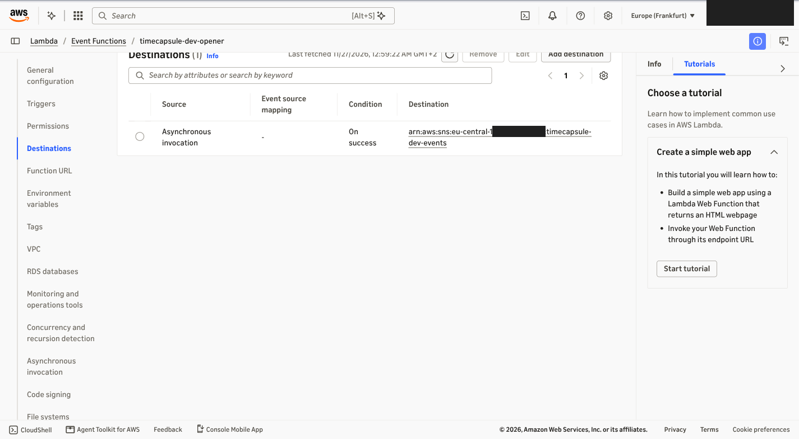

## 9. Сбой обработчика

Для опыта временно задан неверный пароль **только mailer**, после чего через
приложение запечатаны капсулы №8 и №9. Пользователь получил успешный ответ,
а в CloudWatch появились шесть ошибок — по три попытки на каждое сообщение.
Метрика исходной очереди показала два невидимых сообщения, а DLQ — два видимых.
После восстановления пароля выполнен redrive: AWS сообщил `COMPLETED`,
перемещено два сообщения; у каждой капсулы в RDS оказалось ровно одно
уведомление. Параметры `maxReceiveCount` и visibility timeout определяют
число попыток и длительность перехода. В ЛР6 синхронный сбой записи
привёл бы к ошибке запроса вместо постановки письма в очередь.

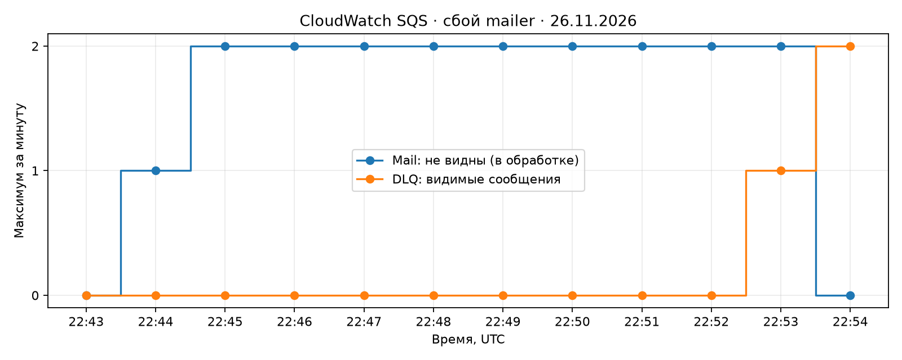
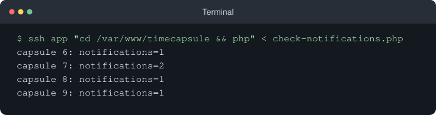

## 10. Архитектура и ADR

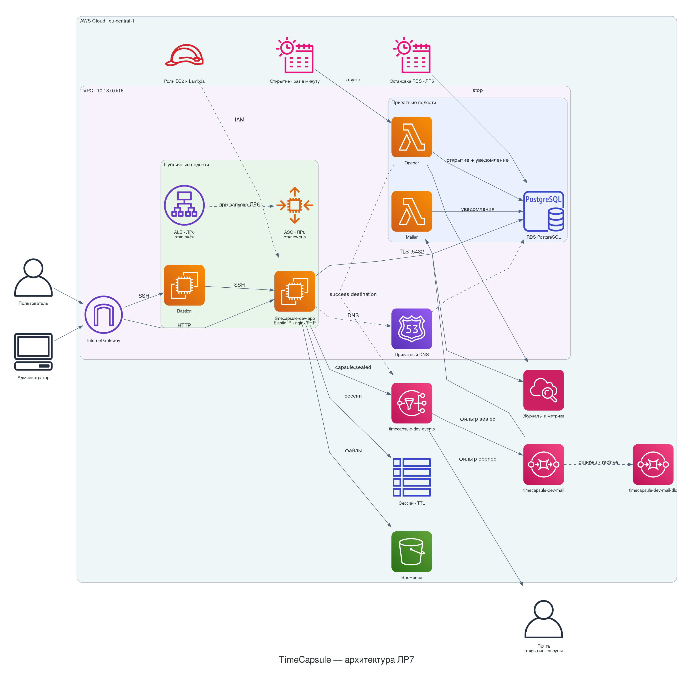

Диаграмма сохраняет компоненты ЛР6, но ALB и ASG помечены как отключённые:
для этой работы использован существующий `timecapsule-dev-app` с Elastic IP.
Решение и альтернативы: [ADR-0006](../adr/0006-background-jobs.md).
Отдельные публичные репозитории обработчиков:
[timecapsule-mailer](https://github.com/LesikAWSLabsAAAAAA/timecapsule-mailer)
и [timecapsule-opener](https://github.com/LesikAWSLabsAAAAAA/timecapsule-opener).

## Контрольные вопросы

**Как событие доходит до уведомления и где теряется?** Приложение сохраняет
капсулу и публикует идентификатор в SNS, SNS доставляет его в SQS, служба
Lambda вызывает mailer, который пишет уведомление в RDS. Сообщение может ждать
в очереди или DLQ; между записью капсулы и публикацией нет общей транзакции,
поэтому при сбое публикации событие может потеряться.

**Чем SNS отличается от SQS?** SNS распространяет событие нескольким
независимым подписчикам и применяет их фильтры. SQS хранит сообщения для
отложенной обработки, повторов и DLQ; здесь вместе они дают разветвление и
буферизацию.

**Что службы делают за функции в VPC?** Служба Lambda опрашивает очередь и
передаёт сообщения коду, а также отправляет запись асинхронного результата в
SNS destination. Поэтому обеим функциям достаточно сетевого доступа к RDS;
роль при этом должна разрешать необходимые операции AWS.

**Что изменилось по сравнению с ЛР2?** Вместо одной машины используются
управляемые RDS, S3, DynamoDB и событийные службы AWS; из запросов вынесены
фоновая работа и открытие капсул. AWS управляет работой сервисов и масштабом,
а мы отвечаем за код, роли, сеть, защиту данных, наблюдение, лимиты и стоимость.

**Где остаются пробелы надёжности?** Commit капсулы и публикация SNS не
атомарны; то же верно для commit открытия и отправки записи назначения.
Для гарантии потребуется transactional outbox, повторная доставка и
мониторинг `DestinationDeliveryFailures`. SQS даёт доставку хотя бы один раз,
а не exactly-once.

## Стоимость и завершение

После занятия SQS-trigger и Scheduler отключены, оба EC2 остановлены,
остановка RDS инициирована; выделенный публичный IPv4-адрес также
тарифицируется. Перед защитой требуется запустить RDS и серверы и включить
оба фоновых триггера, как описано в [инструкции стека](tofu/app/README.md).
Публичный IP bastion изменится при следующем запуске: обновите `~/.ssh/config`.
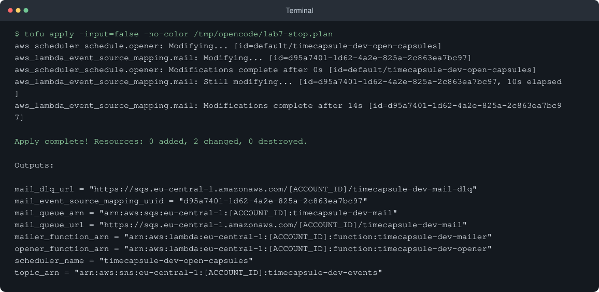
Применение стека ЛР5 с inline-правилами SG может удалить добавленное правилом
ЛР7 разрешение для Lambda: стеки нужно согласовать до последующих изменений.
Пароль БД и email не находятся в репозитории, но присутствуют в локальном
state OpenTofu, а пароль также в конфигурации Lambda; это учебное упрощение.
